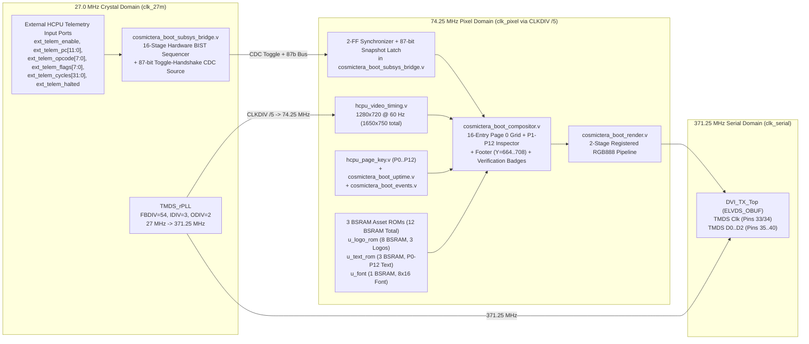

# COSMICTERA — FPGA, DISPLAY & SILICON HARDWARE ARCHITECTURE (`CT-01-REV13`)

> **REVISION NOTICE (`v1.2 — K-01..K-12, R2, CTHETA=0x4E / HDOT=0x52 & GAP-02 Final Edition`):**  
> Paket dokumentasi arsitektur versi `v1.0` sebelumnya dinyatakan **`SUPERSEDED` (Tidak Berlaku sebagai Referensi Rekayasa)** sesuai Keputusan Pemilik (*Owner Architecture Consistency Decision*). Edisi `v1.2` ini menerapkan: (1) definisi resmi label epistemik `R2` dari `cosmictera/RULES.md` (`VF` = *Verified Formally*, `CC` = *Computationally Confirmed*, `DP` = *Design Property*, `EH` = *Engineering Hypothesis*, `AT` = *Aspirational Target*), (2) koreksi penuh `K-01` s.d. `K-12` terhadap `rtl/hcpu_pkg.vh`, `rtl/hcpu_rom.v`, `rtl/hcpu_regfile.v`, `rtl/hcpu_mmio.v`, dan `docs/HISA_SPEC.md`, (3) penetapan resmi `0x4E = CTHETA` (ekstraksi $\hat{\Theta}(H[\text{S1}])$ 8-bit, 1 siklus) dan `0x52 = HDOT` (perkalian titik 14-komponen $\langle H[\text{S1}], H[\text{S2}] \rangle_{14}$ 20-bit, 14 siklus pada `CODEX_PROFILE=2` / 1 siklus pada `CODEX_PROFILE=0,1`; total `105` opcode H-ISA v1.2, `84` di RTL, `21` software-only, `375/375` `test_isa_parity.py` PASS), serta (4) penyelesaian `GAP-02` pada `rtl/hcpu_hisab.v` yang kini menginstansiasi `rtl/hcpu_guard.v` secara kanonik (`R1`).

**Canonical Sources:** `rtl/fpga/gowin/hcpu_gowin_top.v`, `rtl/fpga/gowin/hcpu_hdmi_top.v`, `rtl/fpga/gowin/cosmictera_display_top.v`, `rtl/fpga/gowin/hijaiyyah_kabah_gowin_top.v`, `portal8888/fpga/gowin/hijaiyyah_portal8888_gowin_top.v`, `rtl/mpw/{user_project_wrapper,hcpu_wishbone_wrapper}.v`, `/tmp/stage1_2_cosmictera_boot_ui/rtl/cosmictera_boot_top.v`, `constraints/*.cst`, `cosmictera-build/PAPAN.md`.  
**Primary Physical Target:** Sipeed Tang Nano 20K (`Gowin GW2AR-LV18QN88C8/I7`, kapasitas `20.736` LUT4, `15.552` DFF, `46` BSRAM, `48` MULT9X9 DSP).

---

## 1. Diagram Hierarki Perangkat Keras (`10_fpga_hardware_hierarchy`)

```mermaid
flowchart TB
    subgraph TOP1["1. hcpu_gowin_top.v (UART Compute Top)"]
        G_CORE["hcpu_gowin_core<br/>4Kx32 IMEM + u_report_tx + hcpu_top"]
        H_TOP["hcpu_top (rtl/hcpu_top.v)<br/>u_fetch, u_decode, u_forward, u_execute, u_memory,<br/>u_writeback, u_regfile, u_rom, u_guard, u_codex_alu,<br/>u_hisab, u_uart, u_mmio (u_rx, u_timer, u_sdio),<br/>u_trap, u_dataram, u_controller"]
        G_CORE --> H_TOP
    end

    subgraph TOP2["2. hcpu_hdmi_top.v (Integrated HCPU + HDMI)"]
        HDMI_C["u_hcpu (hcpu_gowin_core) + u_tmds_rpll + u_clkdiv<br/>+ u_timing + u_page + u_tele + u_layout + u_comp<br/>+ u_font + u_render + u_dvi_tx"]
    end

    subgraph TOP3["3. cosmictera_boot_top.v (Stage 1.4 Boot Display Top)"]
        BOOT_C["u_tmds_rpll + u_clkdiv + u_reset_seq + u_subsys_bridge<br/>+ u_timing + u_page + u_uptime + u_events + u_logo_rom (8 BSRAM)<br/>+ u_text_rom (3 BSRAM) + u_font (1 BSRAM) + u_comp + u_render + u_dvi_tx"]
    end

    subgraph TOP4["4. hijaiyyah_kabah_gowin_top.v (Ka'bah FPGA Top)"]
        KAB_C["hijaiyyah_kabah_top (u_des, u_gate, u_count, u_sponge,<br/>u_impulse, u_core [sbox_router, sbox, linear, round_constants])<br/>+ optional hijaiyyah_hmac (Layer 3)"]
    end

    subgraph TOP5["5. hijaiyyah_portal8888_gowin_top.v (Portal 8888 Top)"]
        P88_C["hijaiyyah_portal8888 (u_timestamp, u_ingress,<br/>u_frame_sha256, u_hmac, key_mem[512], frame_mem[9216])"]
    end

    subgraph TOP6["6. user_project_wrapper.v (Caravel Sky130 MPW Top)"]
        MPW_C["hcpu_wishbone_wrapper -> hcpu_top + 4Kx32 IMEM"]
    end
```

---

## 2. Enam Pembungkus Top-Level Perangkat Keras & Utilisasi Terukur

Karena satu chip `GW2AR-LV18QN88C8/I7` memiliki `20.736` LUT4 dan `46` BSRAM, arsitektur perangkat keras CosmicTera menyediakan **lima top-level FPGA Gowin** (dimuat secara bergantian melalui JTAG/SRAM atau diintegrasikan sesuai anggaran sumber daya) serta **satu top-level ASIC MPW Caravel Sky130**:

| No | Modul Top-Level | Berkas Sumber | Submodul Utama yang Diinstansiasi | Utilisasi Terukur (`synth_gowin` + `nextpnr-himbaechel`) | Domain Clock & Fmax | Label |
| :---: | :--- | :--- | :--- | :--- | :--- | :---: |
| **1** | `hcpu_gowin_top` | `rtl/fpga/gowin/hcpu_gowin_top.v` | `hcpu_gowin_core` (`u_hcpu` [`hcpu_top` dengan `USE_DSP=0`, `CODEX_PROFILE=2`], `imem` 4K×32 BSRAM, `u_report_tx`) | **`15.453 / 20.736` LUT4 (`74%`)**, `5.166 / 15.552` DFF (`33%`), **`18 / 46` BSRAM (`39%`)**, `0` DSP | `27,0` MHz (`Fmax = 120,63` MHz) | `DP` |
| **2** | `hcpu_hdmi_top` | `rtl/fpga/gowin/hcpu_hdmi_top.v` | `hcpu_gowin_core` (`USE_DSP=1`) + `TMDS_rPLL` + `CLKDIV` + `hcpu_video_timing` + `hcpu_page_key` + `hcpu_telemetry` + `hcpu_layout_rom` + `hcpu_compositor` + `hcpu_font_rom` + `hcpu_text_render` + `DVI_TX_Top` | **`18.370 / 20.736` LUT4 (`88%`)**, `5.211 / 15.552` DFF (`33%`), **`35 / 46` BSRAM (`76%`)** (dengan `USE_DSP=1`) | `27,0` MHz / `74,25` MHz (`54,73` MHz Fmax) / `371,25` MHz | `CC` |
| **3a** | `cosmictera_display_top` (Baseline Repo M5.3a) | `rtl/fpga/gowin/cosmictera_display_top.v` | `TMDS_rPLL` + `CLKDIV` + `hcpu_video_timing` + `hcpu_page_key` + `hcpu_layout_rom` + `hcpu_compositor` (`snap_valid=0`) + `hcpu_font_rom` + `hcpu_text_render` + `DVI_TX_Top` | **`685 / 20.736` LUT4 (`3%`)**, `122` DFF, **`12 / 46` BSRAM (`26%`)** | `27,0` / `74,25` (`118,91` MHz Fmax) / `371,25` MHz | `DP` |
| **3b** | `cosmictera_boot_top` (Stage 1.4 Official Boot UI) | `/tmp/stage1_2_cosmictera_boot_ui/rtl/cosmictera_boot_top.v` | `TMDS_rPLL` + `CLKDIV` + `cosmictera_boot_reset_seq` + `cosmictera_boot_subsys_bridge` (16-stage BIST + 87b CDC) + `hcpu_video_timing` + `hcpu_page_key` (`MAX_PAGE=12`) + `cosmictera_boot_uptime` + `cosmictera_boot_events` + `cosmictera_boot_logo_rom` (`8` BSRAM) + `cosmictera_boot_text_rom` (`3` BSRAM) + `hcpu_font_rom` (`1` BSRAM) + `cosmictera_boot_compositor` + `cosmictera_boot_render` + `DVI_TX_Top` | **`2.526 / 20.736` LUT4 (`12,18%`)**, `664 / 15.552` DFF (`4,27%`), **`12 / 46` BSRAM (`26,09%`)**, `0` DSP | `27,0` MHz (`102,42` MHz Fmax) / **`74,25` MHz (`84,53` MHz Fmax, `+10,28` MHz slack)** / `371,25` MHz | `DP` |
| **4** | `hijaiyyah_kabah_gowin_top` | `rtl/fpga/gowin/hijaiyyah_kabah_gowin_top.v` | `hijaiyyah_kabah_top` (`u_des`, `u_gate`, `u_count`, `u_sponge`, `u_impulse`, `u_core`) + opsional `hijaiyyah_hmac` (`KABAH_WITH_HMAC`) | Tanpa HMAC: `9.329` LUT4 (`45%`), `2.548` DFF (`DP`); Dengan HMAC: **`15.030` LUT4 (`72%`)**, `4.132` DFF (`CC`) | `27,0` MHz (`70,94` MHz Fmax dengan HMAC) | `DP` / `CC` |
| **5** | `hijaiyyah_portal8888_gowin_top` | `portal8888/fpga/gowin/hijaiyyah_portal8888_gowin_top.v` | `hijaiyyah_portal8888` (`u_timestamp`, `u_ingress`, `u_frame_sha256`, `u_hmac`, `key_mem[512]`, `frame_mem[9216]`) | `11/11` testbench RTL lulus (`CC`); menggunakan BSRAM untuk buffer 9 KB + kunci 512 B | `27,0` MHz | `CC` |
| **6** | `user_project_wrapper` (Sky130 Caravel MPW) | `rtl/mpw/user_project_wrapper.v` | `hcpu_wishbone_wrapper` (`0x3000_0000`) -> `hcpu_top` + 4K×32 IMEM | Lulus `tb_wishbone_wrapper.v` (`8/8` PASS) & lint (`CC`); GDSII fisik `AT` | `wb_clk_i` | `CC` / `AT` |

---

## 3. Arsitektur Subsistem Tampilan Boot HDMI Stage 1.4 (`11_boot_display_and_telemetry`)

### 3.1 Tiga Domain Clock & CDC 87-Bit (`cosmictera_boot_top.v` & `cosmictera_boot_subsys_bridge.v`)
1. **`clk_27m` (`27,0 MHz`, Pin 4)**:
   - Menjalankan `cosmictera_boot_reset_seq.v` (menahan reset sistem hingga `pll_lock` stabil) dan sisi sumber `cosmictera_boot_subsys_bridge.v`.
   - Saat `ext_telem_enable = 0`, jembatan menjalankan **16-Stage Hardware BIST Sequencer** yang menguji dan menyapu 16 entri ekosistem (`#00 HCPU` s.d. `#15 NUI`). Saat `ext_telem_enable = 1`, jembatan memilih input telemetri hidup (`ext_telem_pc[11:0]`, `ext_telem_opcode[7:0]`, `ext_telem_flags[7:0]`, `ext_telem_cycles[31:0]`, `ext_telem_halted`).
   - Mengirimkan paket **87-bit snapshot** melintasi batas domain clock menggunakan **jabat tangan toggle 2-FF (`cdc_req_toggle` / `cdc_ack_toggle`)** sehingga bebas dari kondisi balapan multi-bit (*data tearing*).
2. **`clk_pixel` (`74,25 MHz`, keluaran `CLKDIV /5`)**:
   - Menjalankan `hcpu_video_timing.v` (`1280×720` aktif di dalam total `1650×750` @ `60 Hz`), `hcpu_page_key.v` (debounce tombol `S2` untuk siklus halaman `P0` s.d. `P12`), `cosmictera_boot_uptime.v` (`HH:MM:SS`), `cosmictera_boot_events.v`, 3 ROM aset BSRAM (`12` BSRAM total), `cosmictera_boot_compositor.v`, dan `cosmictera_boot_render.v` (pipa RGB888 2-tahap).
3. **`clk_serial` (`371,25 MHz`, keluaran `TMDS_rPLL` `27 × 55 / 4 = 371,25 MHz`)**:
   - Menjalankan serializer 10:1 `OSER10` dan buffer diferensial `ELVDS_OBUF` di dalam `DVI_TX_Top` untuk memancarkan 4 pasang sinyal TMDS ke TV LG.

### 3.2 Analisis Penggabungan SoC Terpadu (Keputusan Opsi 2 Stage 1.4)
Berdasarkan penjumlahan hasil sintesis terpisah (`hcpu_gowin_core` `15.453` LUT4 + `18` BSRAM dan `cosmictera_boot_top` `2.526` LUT4 + `12` BSRAM):
- **Penjumlahan kasar**: `15.453 + 2.526 = 17.979 / 20.736` LUT4 (`86,70%`, sisa `2.757` LUT4) dan `18 + 12 = 30 / 46` BSRAM (`65,22%`, sisa `16` BSRAM).
- Jika ROM logo dipadatkan dari `8` BSRAM menjadi `4` BSRAM (Opsi 2 Pemilik), total BSRAM turun menjadi `26 / 46` (`56,52%`), memberikan ruang kelonggaran routing bagi `nextpnr-himbaechel` untuk menjaga penutupan waktu `74,25` MHz.

---

## 4. Pemetaan Pin Fisik Kanonik — CST Candidate B (`constraints/cosmictera_tangnano20k.cst`)

Candidate B telah terbukti secara fisik pada TV LG (`#060C16` Deep Space Navy, kanal RGB akurat, 0 kedipan):

| Sinyal Top-Level | Nomor Pin (`GW2AR-LV18QN88`) | Standar I/O & Konfigurasi | Fungsi Fisik |
| :--- | :---: | :--- | :--- |
| `clk_27m` | `Pin 4` | `LVCMOS33 PULL_MODE=UP` | Osilator kristal 27,0 MHz on-board |
| `btn_rst_n` / `key_reset` | `Pin 88` (`S1`) | `LVCMOS33 PULL_MODE=DOWN` (diinvert di top-level) | Tombol Reset (`S1` aktif-tinggi di papan) |
| `key_page` | `Pin 87` (`S2`) | `LVCMOS33 PULL_MODE=DOWN` (diinvert di top-level) | Tombol Siklus Halaman `P0–P12` (`S2`) |
| `uart_txd` / `uart_rxd` | `Pin 69` / `Pin 70` | `LVCMOS33 PULL_MODE=UP` | Jembatan USB-UART BL616 (`115.200 8N1`) |
| `sd_clk`, `sd_cmd`, `sd_dat0` | `Pin 83`, `Pin 82`, `Pin 84` | `LVCMOS33 PULL_MODE=NONE` | Slot Kartu MicroSD 1-bit SDIO |
| `O_tmds_clk_p` / `O_tmds_clk_n` | `Pin 33` / `Pin 34` | `ELVDS_OBUF DRIVE=3.5` | Pasangan Diferensial Clock HDMI TMDS |
| `O_tmds_data_p[0]` / `n[0]` | `Pin 35` / `Pin 36` | `ELVDS_OBUF DRIVE=3.5` | Pasangan Diferensial Data 0 HDMI TMDS (Biru) |
| `O_tmds_data_p[1]` / `n[1]` | `Pin 37` / `Pin 38` | `ELVDS_OBUF DRIVE=3.5` | Pasangan Diferensial Data 1 HDMI TMDS (Hijau) |
| `O_tmds_data_p[2]` / `n[2]` | `Pin 39` / `Pin 40` | `ELVDS_OBUF DRIVE=3.5` | Pasangan Diferensial Data 2 HDMI TMDS (Merah) |
| `led[5:0]` | `Pin 20, 19, 18, 17, 16, 15` | `LVCMOS33 DRIVE=8` | 6 LED Status On-Board (Aktif-Rendah) |
