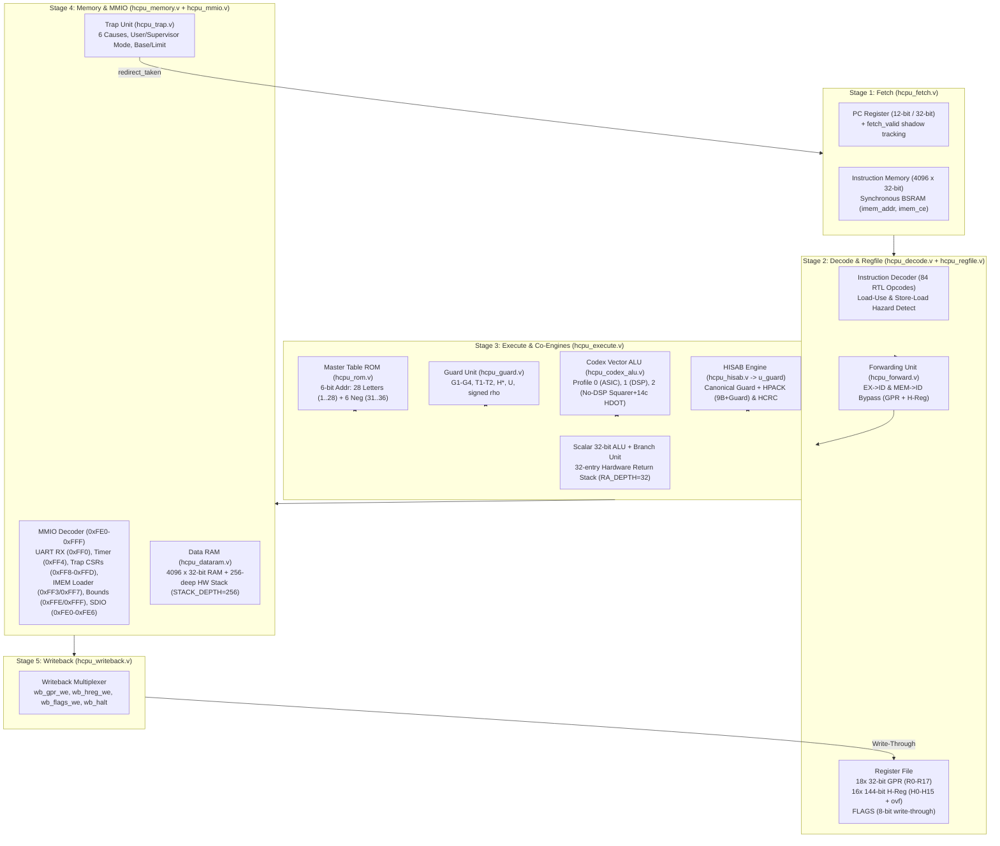

# COSMICTERA — HCPU & H-ISA v1.2 ARCHITECTURE (`CT-01-REV13`)

> **REVISION NOTICE (`v1.2 — K-01..K-12, R2, CTHETA=0x4E / HDOT=0x52 & GAP-02 Final Edition`):**  
> Paket dokumentasi arsitektur versi `v1.0` sebelumnya dinyatakan **`SUPERSEDED` (Tidak Berlaku sebagai Referensi Rekayasa)** sesuai Keputusan Pemilik (*Owner Architecture Consistency Decision*). Edisi `v1.2` ini menerapkan: (1) definisi resmi label epistemik `R2` dari `cosmictera/RULES.md` (`VF` = *Verified Formally*, `CC` = *Computationally Confirmed*, `DP` = *Design Property*, `EH` = *Engineering Hypothesis*, `AT` = *Aspirational Target*), (2) koreksi penuh `K-01` s.d. `K-12` terhadap `rtl/hcpu_pkg.vh`, `rtl/hcpu_rom.v`, `rtl/hcpu_regfile.v`, `rtl/hcpu_mmio.v`, dan `docs/HISA_SPEC.md`, (3) penetapan resmi `0x4E = CTHETA` (ekstraksi $\hat{\Theta}(H[\text{S1}])$ 8-bit, 1 siklus) dan `0x52 = HDOT` (perkalian titik 14-komponen $\langle H[\text{S1}], H[\text{S2}] \rangle_{14}$ 20-bit, 14 siklus pada `CODEX_PROFILE=2` / 1 siklus pada `CODEX_PROFILE=0,1`; total `105` opcode H-ISA v1.2, `84` di RTL, `21` software-only, `375/375` `test_isa_parity.py` PASS), serta (4) penyelesaian `GAP-02` pada `rtl/hcpu_hisab.v` yang kini menginstansiasi `rtl/hcpu_guard.v` secara kanonik (`R1`).


**Canonical Sources:** `docs/HISA_SPEC.md`, `rtl/hcpu_pkg.vh`, `rtl/hcpu_top.v`, `rtl/hcpu_fetch.v`, `rtl/hcpu_decode.v`, `rtl/hcpu_forward.v`, `rtl/hcpu_execute.v`, `rtl/hcpu_memory.v`, `rtl/hcpu_writeback.v`, `rtl/hcpu_controller.v`, `rtl/hcpu_regfile.v`, `rtl/hcpu_rom.v`, `rtl/hcpu_guard.v`, `rtl/hcpu_codex_alu.v`, `rtl/hcpu_hisab.v`, `rtl/hcpu_trap.v`, `rtl/hcpu_mmio.v`, `rtl/hcpu_sdio.v`, `rtl/hcpu_dataram.v`, `src/hijaiyyah/hisa/{opcodes,assembler,machine}.py`.  
**Epistemic Status:** `CC` (Computationally Confirmed — teruji secara fisik pada FPGA Tang Nano 20K `GW2AR-LV18QN88` termasuk burn-in 72 jam tanpa galat).

---

## 1. Diagram Arsitektur Internal HCPU & H-ISA (`05_hcpu_and_hisa_internal_architecture`)




---

## 2. Arsitektur Set Instruksi H-ISA v1.2 (`docs/HISA_SPEC.md` & `rtl/hcpu_pkg.vh`)

### 2.1 Format Kata Instruksi 32-Bit (`ILEN = 32`)
Setiap instruksi H-ISA memiliki lebar tetap 32 bit (`rtl/hcpu_pkg.vh` baris 12):

```
 31          24 23     20 19     16 15     12 11                  0
+--------------+---------+---------+---------+---------------------+
|  OPCODE (8b) | DST (4b)|  S1 (4b)|  S2 (4b)|     IMM12 (12b)     |
+--------------+---------+---------+---------+---------------------+
```

- **`OPCODE [31:24]`**: Pilih salah satu dari **105 opcode resmi** (`84` di RTL, `21` software-only) dalam 8 keluarga instruksi.
- **`DST [23:20]`**: Register tujuan (`R0–R15` atau `H0–H15`). *(Catatan: berkas register fisik memiliki `GPR_COUNT = 18` yaitu `R0–R17` untuk mendukung port internal/compiler, namun field 4-bit di instruksi mengalamati `0..15`).*
- **`S1 [19:16]` & `S2 [15:12]`**: Register sumber 1 dan sumber 2 (`R0–R15` atau `H0–H15`).
- **`IMM12 [11:0]`**: Konstanta langsung 12-bit, alamat memori/cabang (`0x000–0xFFF`), atau indeks komponen vektor (`0–17`).

### 2.2 Peta Eksak Keluarga Opcode H-ISA v1.2 (`105` Spec / `84` RTL di `rtl/hcpu_pkg.vh`, `K-01` s.d. `K-07`)
Berdasarkan `rtl/hcpu_pkg.vh` (baris 129–235), `docs/HISA_SPEC.md`, dan `src/hijaiyyah/hisa/opcodes.py`:

| Keluarga Opcode | Rentang Hex | Total Spec / RTL | Daftar Instruksi RTL (`rtl/hcpu_pkg.vh`) & Instruksi Software-Only (`opcodes.py`) |
| :--- | :---: | :---: | :--- |
| **1. Sistem, Vektor Metrik & File (`K-02`)** | `0x00–0x0B` | `12` / `10` | **RTL (`10`)**: `NOP` (`0x00`), `HALT` (`0x01`), `MOV` (`0x03`), `MOVI` (`0x04`), `HNRM2` (`0x06`), `HDIST` (`0x07`), `ERET` (`0x08`), `SYSCALL` (`0x09`), `FRD` (`0x0A`), `FWR` (`0x0B`). **SW-only (`2`)**: `RESET` (`0x02`), `WAIT` (`0x05`). |
| **2. ALU Aritmetika Skalar (`K-03`)** | `0x10–0x19` | `10` / `4` | **RTL (`4`)**: `ADD` (`0x10`), `ADDI` (`0x11`), `SUB` (`0x12`), `MUL` (`0x14`). **SW-only (`6`)**: `SUBI` (`0x13`), `DIV` (`0x15`), `MOD` (`0x16`), `NEG` (`0x17`), `INC` (`0x18`), `DEC` (`0x19`). |
| **3. Perbandingan, Cabang & Subrutin (`K-04`)** | `0x20–0x2F` | `16` / `9` | **RTL (`9`)**: `CMP` (`0x20`), `CMPI` (`0x21`), `JMP` (`0x22`), `JEQ` (`0x23`), `JNE` (`0x24`), `JGD` (`0x29`: cabang jika `FLAG_G == 1`), `JNGD` (`0x2A`: cabang jika `FLAG_G == 0`), `CALL` (`0x2E`: `RA_DEPTH=32`), `RET` (`0x2F`). **SW-only (`7`)**: `JGT` (`0x25`), `JLT` (`0x26`), `JGE` (`0x27`), `JLE` (`0x28`), `JOVF` (`0x2B`), `JNOVF` (`0x2C`), `JRHO` (`0x2D`). |
| **4. Memori & Tumpukan Data (`K-05`)** | `0x30–0x3B` | `8` / `4` | **RTL (`4`)**: `LOAD` (`0x30`), `STORE` (`0x31`), `PUSH` (`0x32`: `STACK_DEPTH=256`), `POP` (`0x33`). **SW-only (`4`)**: `LOADH` (`0x38`), `STOREH` (`0x39`), `LPUSH` (`0x3A`), `LPOP` (`0x3B`). |
| **5. Operasi Vektor Kodeks (`H-Reg`, `K-06`)** | `0x40–0x4F` | `16` / `11` | **RTL (`11`)**: `HLOAD` (`0x40`), `HCADD` (`0x42`), `CGET` (`0x44`), `CSET` (`0x45`), `CMOV` (`0x46`), `CZERO` (`0x47`), `CEQ` (`0x48`), `CRHO` (`0x4C`), `CU` (`0x4D`), `CTHETA` (`0x4E`: ekstraksi $\hat{\Theta}(H[\text{S1}])$ 8-bit, 1 siklus), `CMOD4` (`0x4F`). **SW-only (`5`)**: `HSTORE` (`0x41`), `HCSUB` (`0x43`), `CNOT` (`0x49`), `CSHL` (`0x4A`), `CSHR` (`0x4B`). |
| **6. HISAB, Dot-Product, Guard, Eksomatriks & Kubus (`K-06`)** | `0x50–0x91` | `10` / `4` | **RTL (`4`)**: `HPACK` (`0x50`), `HCRC` (`0x51`), `HDOT` (`0x52`: produk dalam 14-komponen 20-bit, 14 siklus pada `CODEX_PROFILE=2`), `HGRD` (`0x60`). **SW-only (`6`)**: `HCHK` (`0x68`), `EXOMUL` (`0x70`), `EXOTR` (`0x78`), `CROT` (`0x80`), `QSTEP` (`0x90`), `QMEAS` (`0x91`). |
| **7. I/O, Bitwise/Shift & Error (`K-03`, `K-07`)** | `0xA0–0xBA`, `0xFF` | `16` / `14` | **RTL (`14`)**: `PRINT` (`0xA0`), `EMITS` (`0xA2`), `AND` (`0xB0`), `OR` (`0xB1`), `XOR` (`0xB2`), `NOT` (`0xB3`), `SHL` (`0xB4`), `SHR` (`0xB5`), `ANDI` (`0xB6`), `ORI` (`0xB7`), `XORI` (`0xB8`), `SHLI` (`0xB9`), `SHRI` (`0xBA`), `HALT_ERR` (`0xFF`). **SW-only (`2`)**: `PRINTH` (`0xA1`), `DUMP` (`0xA8`). |
| **8. Huruf Hijaiyyah 1-Based (`K-01`, `K-09`)** | `0xE0–0xFB` | `28` / `28` | **RTL (`28`)**: `L_ALIF` (`0xE0`, indeks ROM `1`) s.d. `L_YA` (`0xFB`, indeks ROM `28`): Membaca $\mathbf{v}(h_i)$ dari `hcpu_rom.v` (`addr = opcode - 0xE0 + 1`) dan mengakumulasikannya ke `H0` (`H0 <- H0 + ROM[i]`). |

---

## 3. Arsitektur Berkas Register (`rtl/hcpu_regfile.v`)

1. **Bank GPR (`gpr[0:17]`)**: `18` register skalar 32-bit (`R0–R17`), dengan dua port baca kombinasional ber-bypass tulis-tembus (*write-through*: jika `gpr_we && gpr_waddr == gpr_raddr`, nilai `gpr_wdata` langsung diteruskan pada siklus yang sama), satu port tulis sinkron, dan port baca ke-3 khusus debug/Wishbone (`dbg_gpr_raddr[4:0]` -> `dbg_gpr_rdata[31:0]`).
2. **Bank H-Reg (`hreg[0:15]` + `hreg_ovf[15:0]`)**: `16` register vektor kodeks 144-bit (`H0–H15`) beserta `16` bit pelacak luapan lane lengket (`hreg_ovf`, Alternative A1), juga dilengkapi *write-through* pada kedua port bacanya.
3. **Register `FLAGS [7:0]`**:
   - Bit 0 (`FLAG_Z`): Zero
   - Bit 1 (`FLAG_LT`): Less Than
   - Bit 2 (`FLAG_GT`): Greater Than
   - Bit 3 (`FLAG_G`): Guard Pass (`guard_led` terhubung langsung ke `flags_out[FLAG_G]`)
   - Bit 4 (`FLAG_C`): Carry / Overflow
   - Bit 5 (`FLAG_E`): Error / Fault
   - Dilengkapi *write-through* (`assign flags_out = flags_we ? flags_in : flags`) untuk mencegah pembacaan flag basi ketika instruksi cabang berada tepat 2 siklus setelah `CMP` (perbaikan bug `hos_alloc` di `rtl/hcpu_regfile.v` baris 79–106).

---

## 4. Pipa Eksekusi 5-Tahap, Forwarding & Resolusi Hazard

| Tahap | Modul RTL | Fungsi Utama & Penanganan Hazard |
| :--- | :--- | :--- |
| **1. IF (Fetch)** | `rtl/hcpu_fetch.v` | Mengelola `if_pc` dan sinyal `pc_valid` (`fetch_valid`). Saat terjadi pengalihan (`redirect_taken` dari cabang atau trap), pipa membilas 2 siklus pengisian ulang BSRAM dan menurunkan `pc_valid <= 0` agar unit trap tidak pernah menyimpan `PC = 0` palsu (`trap_shadow` fix). |
| **2. ID (Decode)** | `rtl/hcpu_decode.v` | Mendekode 84 opcode perangkat keras (dari 105 opcode H-ISA), membaca `gpr`/`hreg`, serta mendeteksi `load_use_hazard` dan `store_load_hazard` secara perangkat keras. |
| **3. EX (Execute)** | `rtl/hcpu_execute.v` + `hcpu_forward.v` | `hcpu_forward.v` melakukan bypass `EX -> ID` dan `MEM -> ID` baik untuk GPR 32-bit maupun H-Reg 144-bit (`+` bit `ovf`). `hcpu_execute.v` mengeksekusi ALU skalar, Return Address Stack 8-entri (`CALL`/`RET`), akses `hcpu_rom`, `hcpu_guard`, `hcpu_codex_alu`, `hcpu_hisab`, serta memeriksa pelanggaran hak istimewa (`priv_fault`) dan batas memori (`mem_fault`). |
| **4. MEM (Memory)** | `rtl/hcpu_memory.v` + `hcpu_mmio.v` + `hcpu_dataram.v` | Mengakses RAM data `4096 × 32-bit` (`0x000–0xFDF`) atau jendela periferal MMIO (`0xFE0–0xFFF`), serta tumpukan perangkat keras (`PUSH`/`POP` dengan pointer `SP`). |
| **5. WB (Writeback)** | `rtl/hcpu_writeback.v` | Menulis kembali hasil ke `hcpu_regfile.v` (`wb_gpr_we`, `wb_hreg_we`, `wb_flags_we`) dan mengunci sinyal `wb_halt`. |

---

## 5. Tiga Profil Perangkat Keras `hcpu_codex_alu.v` (Paket 8 — `rtl/hcpu_codex_alu.v`)

Untuk memenuhi anggaran LUT4 dan DSP pada target FPGA maupun ASIC, `hcpu_codex_alu.v` mengimplementasikan tiga profil arsitektur yang dipilih melalui parameter `CODEX_PROFILE`:

| Profil | Parameter | Arsitektur Datapath `HNRM2` / `HDIST` / `HDOT` | Latensi | Dampak Sumber Daya pada Tang Nano 20K |
| :--- | :---: | :--- | :---: | :--- |
| **Profile A (ASIC / Generic)** | `CODEX_PROFILE = 0` | 14-lane 8×8 MAC terpadu dengan reduksi produk parsial Radix-4 + pohon penjumlah biner seimbang + `abs_diff` pengurang tunggal | `1` siklus (`done = 1`) | Mengurangi LUT4 sebesar `-1.999` dibanding desain awal tanpa DSP |
| **Profile B (FPGA Hard-DSP)** | `CODEX_PROFILE = 1` (`USE_DSP = 1`) | 14-lane 8×8 MAC menggunakan `14` blok keras `MULT9X9` Gowin + pohon CSA | `1` siklus (`done = 1`) | `14.129` LUT4 (`68%`), `18` BSRAM, `14` `MULT9X9` (`Fmax = 120,63` MHz) |
| **Profile C (FPGA No-DSP — Default `hcpu_gowin_core`)** | `CODEX_PROFILE = 2` (`USE_DSP = 0`) | **14-lane Nibble-Split Squarer** (`(16H+L)^2 = {sq4(H), sq4(L)} + ((H*L)<<5)`) untuk `HNRM2`/`HDIST` 1-siklus + **14-siklus pengali geser-jumlah sekuensial** untuk `HDOT` (`calu_done` menahan pipa selama 13 siklus) | `1` siklus (`HNRM2`/`HDIST`), `14` siklus (`HDOT`) | **`15.453` LUT4 (`74%`), `18` BSRAM, `0` DSP (`Fmax = 120,63` MHz)** — membebaskan 100% DSP pada papan |

---

## 6. Peta Memori & Jendela Periferal MMIO Eksak (`rtl/hcpu_mmio.v` & `rtl/hcpu_pkg.vh`, `K-10` & `K-11`)

Ruang alamat data HCPU berukuran `4096` kata 32-bit (`0x000–0xFFF`):
- **`0x000–0xFDF` (`4.064` kata)**: RAM Data (`hcpu_dataram.v`).
- **`0xFE0–0xFEF` (`16` kata — Blok Kartu SDIO, `is_sd = is_periph & ~addr[4]`, `rtl/hcpu_pkg.vh` baris 107–115)**:
  - **`0xFE0` (`SD_CMD`, W)**: Memulai operasi kartu (`SD_OP_INIT = 2'd1`, `SD_OP_READ = 2'd2`, `SD_OP_WRITE = 2'd3`).
  - **`0xFE1` (`SD_STATUS`, R)**: `{24'd0, sd_err_code[3:0], sd_card_ready, sd_err, sd_ok, sd_busy}`.
  - **`0xFE2` (`SD_SECTOR`, RW)**: Nomor sektor LBA 32-bit.
  - **`0xFE3` (`SD_DATA`, RW)**: Port streaming buffer sektor 128-kata (auto-increment `sd_index[6:0]` setiap baca/tulis).
  - **`0xFE4` (`SD_CONTROL`, RW)**: Bit `[0]` reset `sd_index`, Bit `[1]` `sd_soft_rst`, Bit `[3:2]` pembagi clock SPI/SDIO (`sd_div`).
  - **`0xFE5` (`SD_CSUM`, R)**: Checksum XOR 32-bit perangkat keras atas 128 kata sektor yang dibaca.
  - **`0xFE6` (`SD_PRESCAN`, R)**: Status pra-pemindaian perangkat keras `{30'd0, sd_prescan_all_zero, sd_prescan_has_magic}`.
  - **`0xFE7–0xFEF`**: Cadangan bebas (mengembalikan `32'd0`).
- **`0xFF0–0xFFF` (`16` kata — Blok Periferal Inti & Trap, `is_core = is_periph & addr[4]`, `rtl/hcpu_pkg.vh` baris 68–103)**:
  - **`0xFF0` (`REG_RX_DATA`, R)**: Byte data UART RX (`{24'd0, rx_held}`; membaca register ini menghapus `rx_ready` dan `rx_overrun`).
  - **`0xFF1` (`REG_RX_STATUS`, R)**: `{29'd0, rx_overrun, rx_held_err, rx_ready}`.
  - **`0xFF2` (`REG_TX_STATUS`, R)**: `{31'd0, uart_tx_busy}`.
  - **`0xFF3` (`REG_IMEM_ADDR`, RW)**: Alamat tulis memori instruksi (`imem_waddr[11:0]`).
  - **`0xFF4` (`REG_COUNTER`, R)**: Pencacah siklus bebas 32-bit (`hcpu_timer.v`).
  - **`0xFF5` (`REG_COMPARE`, RW)**: Nilai batas waktu timer 32-bit (menulis ke sini menghapus `expired`).
  - **`0xFF6` (`REG_TIMER_ST`, RW)**: Bit `[0]` `tmr_expired` (menulis ke sini menghapus interupsi timer).
  - **`0xFF7` (`REG_IMEM_DATA`, W)**: Menulis kata instruksi 32-bit ke IMEM secara kombinasional (`imem_we = 1`) dan menaikkan `imem_waddr` secara otomatis (`+1`).
  - **`0xFF8` (`REG_TRAP_VECTOR`, RW)**: Alamat vektor penangan trap (`trap_vector[11:0]`).
  - **`0xFF9` (`REG_TRAP_EPC`, RW)**: Alamat instruksi kembali (`trap_epc[11:0]`).
  - **`0xFFA` (`REG_TRAP_CAUSE`, R)**: Kode penyebab trap (`CAUSE_TIMER = 0`, `CAUSE_UART_RX = 1`, `CAUSE_ILLEGAL = 2`, `CAUSE_PRIV = 3`, `CAUSE_MEM = 4`, `CAUSE_SYSCALL = 5`).
  - **`0xFFB` (`REG_TRAP_ENABLE`, RW)**: Masker pengaktif interupsi eksternal (`[0]`=Timer, `[1]`=UART RX).
  - **`0xFFC` (`REG_TRAP_PENDING`, R)**: Bit interupsi yang sedang tertunda (`trap_pending[1:0]`).
  - **`0xFFD` (`REG_TRAP_MODE`, RW)**: Register mode hak istimewa (`{30'd0, in_user, mode}`; di `hcpu_pkg.vh` `MODE_USER = 0`, `MODE_SUPER = 1`, sedangkan di `hcpu_trap.v` penulisan bit `[1] = 1` menjadwalkan masuk ke User Mode saat `ERET`).
  - **`0xFFE` (`REG_MEM_BASE`, RW)**: Batas bawah alamat memori data mode User (`mem_base[11:0]`).
  - **`0xFFF` (`REG_MEM_LIMIT`, RW)**: Batas atas alamat memori data mode User (`mem_limit[11:0]`, default reset `0xFFF`).


---

## Lampiran Verifikasi Forensik `v1.2`: Matriks Kebenaran Kanonik `K-01` s.d. `K-12` (`rtl/hcpu_pkg.vh`, `rtl/hcpu_rom.v`, `rtl/hcpu_mmio.v`, `docs/HISA_SPEC.md`)

Tabel berikut mengunci parameter perangkat keras dan encoding instruksi aktual langsung dari berkas RTL kanonik (`rtl/hcpu_pkg.vh`, `rtl/hcpu_rom.v`, `rtl/hcpu_regfile.v`, `rtl/hcpu_execute.v`, `rtl/hcpu_memory.v`, `rtl/hcpu_mmio.v`, `rtl/hcpu_trap.v`):

| Kode Koreksi | Domain Arsitektur | Spesifikasi Eksak di Sumber Kanonik (`rtl/` & `docs/HISA_SPEC.md`) |
| :--- | :--- | :--- |
| **`K-01`** | **Opcode Huruf Hijaiyyah (`28` Huruf)** | **`0xE0–0xFB`** (`OP_L_ALIF = 8'hE0` s.d. `OP_L_YA = 8'hFB` di `rtl/hcpu_pkg.vh` baris 195–222; `OpCode.L_ALIF..OpCode.L_YA` di `opcodes.py`). Alamat ROM dihitung sebagai `id_opcode - OP_L_ALIF + 1` (`1..28`, 1-based). |
| **`K-02`** | **Opcode Sistem & Kontrol (`0x00–0x0B`)** | `NOP = 0x00`, `HALT = 0x01`, `MOV = 0x03`, `MOVI = 0x04`, `HNRM2 = 0x06`, `HDIST = 0x07`, `ERET = 0x08`, `SYSCALL = 0x09`, `FRD = 0x0A`, `FWR = 0x0B` (`rtl/hcpu_pkg.vh` baris 129–139). (`RESET = 0x02` dan `WAIT = 0x05` hanya di perangkat lunak). |
| **`K-03`** | **Opcode Aritmetika (`0x10–0x14`) & Bitwise (`0xB0–0xBA`)** | **Aritmetika RTL**: `ADD = 0x10`, `ADDI = 0x11`, `SUB = 0x12`, `MUL = 0x14` (`SUBI=0x13`, `DIV=0x15`, `MOD=0x16`, `NEG=0x17`, `INC=0x18`, `DEC=0x19` hanya di perangkat lunak). **Bitwise/Shift RTL**: `AND = 0xB0`, `OR = 0xB1`, `XOR = 0xB2`, `NOT = 0xB3`, `SHL = 0xB4`, `SHR = 0xB5`, `ANDI = 0xB6`, `ORI = 0xB7`, `XORI = 0xB8`, `SHLI = 0xB9`, `SHRI = 0xBA` (`rtl/hcpu_pkg.vh` baris 142–145 & 225–235). |
| **`K-04`** | **Opcode Compare, Branch & Call (`0x20–0x2F`)** | **RTL**: `CMP = 0x20`, `CMPI = 0x21`, `JMP = 0x22`, `JEQ = 0x23`, `JNE = 0x24`, `JGD = 0x29` (cabang jika `FLAG_G == 1`), `JNGD = 0x2A` (cabang jika `FLAG_G == 0`), `CALL = 0x2E`, `RET = 0x2F` (`rtl/hcpu_pkg.vh` baris 148–156). (`JGT=0x25`, `JLT=0x26`, `JGE=0x27`, `JLE=0x28`, `JOVF=0x2B`, `JNOVF=0x2C`, `JRHO=0x2D` hanya di perangkat lunak; tidak ada `JMOD4` di RTL). |
| **`K-05`** | **Opcode Memori & Stack (`0x30–0x33`) & Kedalaman Stack** | **RTL**: `LOAD = 0x30`, `STORE = 0x31`, `PUSH = 0x32`, `POP = 0x33` (`rtl/hcpu_pkg.vh` baris 159–162; `LOADH=0x38`, `STOREH=0x39`, `LPUSH=0x3A`, `LPOP=0x3B` hanya di perangkat lunak). **Return Address Stack (`CALL`/`RET`)**: `RA_DEPTH = 32` (`32 × 12-bit` di `rtl/hcpu_execute.v` baris 121). **Data Stack (`PUSH`/`POP`)**: `STACK_DEPTH = 256` (`256 × 32-bit` di `rtl/hcpu_memory.v` baris 81). |
| **`K-06`** | **Opcode Codex, Guard & HISAB (`0x40–0x60`)** | **RTL**: `HLOAD = 0x40`, `HCADD = 0x42`, `CGET = 0x44`, `CSET = 0x45`, `CMOV = 0x46`, `CZERO = 0x47`, `CEQ = 0x48`, `CRHO = 0x4C`, `CU = 0x4D`, **`CTHETA = 0x4E`** (`OP_CTHETA = 8'h4E`, ekstraksi $\hat{\Theta}(H[\text{S1}])$ 8-bit, 1 siklus), `CMOD4 = 0x4F`, `HPACK = 0x50`, `HCRC = 0x51`, **`HDOT = 0x52`** (`OP_HDOT = 8'h52`, produk dalam 14-komponen 20-bit via `ALU_HDOT`, 14 siklus pada `CODEX_PROFILE=2`), `HGRD = 0x60` (`HCHK = 0x68` hanya di perangkat lunak). |
| **`K-07`** | **Opcode I/O & Error (`0xA0–0xFF`) & Total Opcode** | **RTL**: `PRINT = 0xA0`, `EMITS = 0xA2`, `HALT_ERR = 0xFF` (`PRINTH = 0xA1` dan `DUMP = 0xA8` hanya di perangkat lunak). **Total Opcode**: **`105` opcode unik** di `docs/HISA_SPEC.md` dan `OpCode` di `src/hijaiyyah/hisa/opcodes.py` (`0` alias); **`84` diimplementasikan di RTL** (`rtl/hcpu_pkg.vh` & `RTL_IMPLEMENTED`, termasuk `28` opcode huruf `0xE0–0xFB`, `CTHETA = 0x4E`, dan `HDOT = 0x52`) serta **`21` software-only** (`cosmictera-build/OFF.md`). |
| **`K-08`** | **Pemetaan Bit `FLAGS` (`rtl/hcpu_pkg.vh` baris 56–59)** | `FLAG_G = 0` (`bit 0`: Guard pass), `FLAG_Z = 1` (`bit 1`: Zero), `FLAG_O = 2` (`bit 2`: Overflow), `FLAG_LT = 3` (`bit 3`: Less-than). |
| **`K-09`** | **Struktur `rtl/hcpu_rom.v` (`ROM_ADDR_W = 6`)** | Alamat **6-bit (`addr[5:0]`, `0..63`)**: indeks **`1..28`** adalah 28 huruf Hijaiyyah kanonik (1-based: `1 = Alif` .. `28 = Ya`); indeks **`31..36`** adalah **6 vektor uji negatif** untuk verifikasi perangkat keras (`31` gagal `G4`, `32` gagal `G1`, `33` gagal `G2`, `34` gagal `G3`, `35` gagal `T1`, `36` gagal `T2`); indeks `0`, `29`, `30`, `37..63` mengembalikan `valid = 0` dan `144'd0`. Total entri valid = `34` (`28 + 6`). |
| **`K-10`** | **Peta MMIO Blok SDIO (`0xFE0–0xFE6`)** | `0xFE0 = SD_CMD` (W: `1`=INIT, `2`=READ, `3`=WRITE), `0xFE1 = SD_STATUS` (R: `{24'd0, err_code[3:0], card_ready, err, ok, busy}`), `0xFE2 = SD_SECTOR` (RW: 32-bit LBA), `0xFE3 = SD_DATA` (RW: 128-word buffer port, auto-inc `sd_index`), `0xFE4 = SD_CONTROL` (RW: bit 0 reset index, bit 1 soft reset, bits `[3:2]` clock div), `0xFE5 = SD_CSUM` (R: XOR checksum), `0xFE6 = SD_PRESCAN` (R: `{30'd0, all_zero, has_magic}`). `0xFE7–0xFEF` tidak terpakai (`0`). |
| **`K-11`** | **Peta MMIO Blok Inti (`0xFF0–0xFFF`), Trap & Privilege** | `0xFF0 = REG_RX_DATA`, `0xFF1 = REG_RX_STATUS`, `0xFF2 = REG_TX_STATUS`, **`0xFF3 = REG_IMEM_ADDR`**, `0xFF4 = REG_COUNTER`, `0xFF5 = REG_COMPARE`, `0xFF6 = REG_TIMER_ST`, **`0xFF7 = REG_IMEM_DATA`**, `0xFF8 = REG_TRAP_VECTOR`, `0xFF9 = REG_TRAP_EPC`, `0xFFA = REG_TRAP_CAUSE` (**`0`=Timer, `1`=UART_RX, `2`=Illegal, `3`=Priv, `4`=Mem, `5`=Syscall**), `0xFFB = REG_TRAP_ENABLE`, `0xFFC = REG_TRAP_PENDING`, `0xFFD = REG_TRAP_MODE` (**`MODE_USER = 0`, `MODE_SUPER = 1`** di `hcpu_pkg.vh`; bit `[1]` di `hcpu_trap.v` mengaktifkan proteksi User), **`0xFFE = REG_MEM_BASE`**, **`0xFFF = REG_MEM_LIMIT`**. |
| **`K-12`** | **Bank Register (`hcpu_regfile.v`) & Model Lapisan** | **GPR**: `GPR_COUNT = 18` (`R0–R17` × 32-bit fisik di `hcpu_regfile.v`, sedangkan field instruksi 4-bit mengalamati `R0–R15`). **H-Reg**: `HREG_COUNT = 16` (`H0–H15` × `144-bit` + `hreg_ovf[15:0]` di `hcpu_regfile.v`; berbeda dari tabel warisan `HISA_SPEC.md` §3.2 yang mencantumkan `4` `H0–H3` × `576-bit`). **Model Lapisan**: membedakan secara eksplisit (a) **5-Lapis Keamanan Ka'bah** (`cosmictera/RULES.md` R10: L0 Kanonik `DP`, L1 Guard `CC`, L2 Serapan `EH`, L3 Autentik `VF`, L4 Rahasia ditolak), (b) **7-Lapis `cosmictera/SYSTEM.md`**, (c) **11-Lapis `docs/ARCHITECTURE.md`**, (d) **12-Lapis `NUI/LAYERS.md` (`L0–L11`)**, dan (e) **13-Lapis `COSMICTERA_CT01_REV13_AUDIT.md`**. |
