# COSMICTERA — COMPLETE HARDWARE & SOFTWARE INTERFACE MATRIX (`CT-01-REV13`)

> **REVISION NOTICE (`v1.2 — K-01..K-12, R2, CTHETA=0x4E / HDOT=0x52 & GAP-02 Final Edition`):**  
> Paket dokumentasi arsitektur versi `v1.0` sebelumnya dinyatakan **`SUPERSEDED` (Tidak Berlaku sebagai Referensi Rekayasa)** sesuai Keputusan Pemilik (*Owner Architecture Consistency Decision*). Edisi `v1.2` ini menerapkan: (1) definisi resmi label epistemik `R2` dari `cosmictera/RULES.md` (`VF` = *Verified Formally*, `CC` = *Computationally Confirmed*, `DP` = *Design Property*, `EH` = *Engineering Hypothesis*, `AT` = *Aspirational Target*), (2) koreksi penuh `K-01` s.d. `K-12` terhadap `rtl/hcpu_pkg.vh`, `rtl/hcpu_rom.v`, `rtl/hcpu_regfile.v`, `rtl/hcpu_mmio.v`, dan `docs/HISA_SPEC.md`, (3) penetapan resmi `0x4E = CTHETA` (ekstraksi $\hat{\Theta}(H[\text{S1}])$ 8-bit, 1 siklus) dan `0x52 = HDOT` (perkalian titik 14-komponen $\langle H[\text{S1}], H[\text{S2}] \rangle_{14}$ 20-bit, 14 siklus pada `CODEX_PROFILE=2` / 1 siklus pada `CODEX_PROFILE=0,1`; total `105` opcode H-ISA v1.2, `84` di RTL, `21` software-only, `375/375` `test_isa_parity.py` PASS), serta (4) penyelesaian `GAP-02` pada `rtl/hcpu_hisab.v` yang kini menginstansiasi `rtl/hcpu_guard.v` secara kanonik (`R1`).

**Canonical Sources:** `rtl/hcpu_top.v`, `rtl/hcpu_mmio.v`, `rtl/fpga/gowin/hcpu_gowin_top.v`, `rtl/fpga/gowin/hcpu_hdmi_top.v`, `/tmp/stage1_2_cosmictera_boot_ui/rtl/cosmictera_boot_top.v`, `/tmp/stage1_2_cosmictera_boot_ui/rtl/cosmictera_boot_subsys_bridge.v`, `rtl/mpw/hcpu_wishbone_wrapper.v`, `portal8888/rtl/hijaiyyah_portal8888.v`, `constraints/cosmictera_tangnano20k.cst`.

---

## 1. Diagram Matriks Antarmuka Lengkap (`14_complete_interface_matrix`)

```mermaid
flowchart LR
    subgraph INT_HW["Hardware Internal Interfaces"]
        I_IMEM["IMEM Bus: imem_addr[11:0], imem_ce, imem_data[31:0]<br/>+ Loader Write (0xFF3/0xFF7): imem_we, imem_waddr[11:0], imem_wdata[31:0]"]
        I_DRAM["DRAM / MMIO Bus: addr[11:0], re, we, wdata[31:0], rdata[31:0]<br/>RAM: 0x000-0xFDF | SDIO: 0xFE0-0xFE6 | Core: 0xFF0-0xFFF"]
        I_TELE["HCPU Telemetry Bus (84b / 87b CDC):<br/>tele_pc[11:0], tele_instr[31:0], tele_cycles[31:0],<br/>tele_flags[7:0], tele_halted, tele_guard"]
        I_WB["Caravel Wishbone B4 Slave (0x3000_0000):<br/>wbs_adr_i[31:0], wbs_dat_i/o[31:0], wbs_cyc/stb/we/ack"]
    end

    subgraph INT_PIN["Physical Pin & Wire Interfaces (Tang Nano 20K)"]
        P_CLK["Clock & Input Pins:<br/>clk_27m (Pin 4), btn_rst_n (Pin 88 S1), key_page (Pin 87 S2)"]
        P_UART["UART Serial:<br/>uart_txd (Pin 69), uart_rxd (Pin 70) @ 115,200 8N1"]
        P_SD["MicroSD 1-Bit SDIO:<br/>sd_clk (Pin 83), sd_cmd (Pin 82), sd_dat0 (Pin 84)"]
        P_HDMI["HDMI TMDS (Candidate B):<br/>Clk=33/34, D0=35/36, D1=37/38, D2=39/40 (ELVDS_OBUF)"]
        P_LED["On-Board LEDs (Active-Low):<br/>led[5:0] -> Pins 15, 16, 17, 18, 19, 20"]
    end

    subgraph INT_SW["Software & Protocol Bridges"]
        S_HISAB["HISAB v1.0 Frame Protocol:<br/>Header 'HB' (0x48,0x42,0x01,type) + 9B Nibble Payload + 1B Guard + 4B CRC32"]
        S_LIMA["NUI Layer 5 Host Bridge:<br/>limactl shell cosmictera-layer5 -- <allowlisted_argv>"]
    end

    INT_HW <--> INT_PIN
    INT_PIN <--> INT_SW
```

---

## 2. Tabel Matriks Antarmuka Internal & Eksternal

| ID Antarmuka | Produsen (Sumber) | Konsumen (Tujuan) | Nama Sinyal / Port & Lebar Bit | Domain Clock | Protokol & Timing | Status |
| :--- | :--- | :--- | :--- | :--- | :--- | :---: |
| **IF-01: IMEM Read Bus** | `hcpu_fetch` (`rtl/hcpu_fetch.v`) | BSRAM `imem` (`hcpu_gowin_core`) | `imem_addr[11:0]` (Out), `imem_ce` (Out), `imem_data[31:0]` (In) | `clk` (`27 MHz`) | Sinkron BSRAM 1-siklus (`fetch_valid` turun 2 siklus saat redirect) | `DP` |
| **IF-02: IMEM Privileged Loader Write Bus** | `hcpu_mmio` (`rtl/hcpu_mmio.v` `0xFF3=IMEM_ADDR`, `0xFF7=IMEM_DATA`) | BSRAM `imem` (`hcpu_gowin_core`) | `imem_we` (Out, kombinasional), `imem_waddr[11:0]` (Out, auto-inc `+1`), `imem_wdata[31:0]` (Out) | `clk` (`27 MHz`) | Tulis kombinasional pada saat `STORE` ke `0xFF7` (`REG_IMEM_DATA`) agar alamat tidak bergeser 1 kata | `DP` |
| **IF-03: CPU ↔ MMIO / Data RAM Bus** | `hcpu_memory` (`rtl/hcpu_memory.v`) & FSM `EMITS` | `hcpu_mmio` & `hcpu_dataram` | `dram_re` (1b), `dram_we` (1b), `dram_addr[11:0]`, `dram_wdata[31:0]`, `dram_rdata[31:0]` | `clk` (`27 MHz`) | Baca terdaftar 1-siklus (`0x000–0xFDF` RAM, `0xFE0–0xFE6` SDIO, `0xFF0–0xFFF` Core) | `DP` |
| **IF-04: Execute ↔ Master Table ROM** | `hcpu_execute` (`rtl/hcpu_execute.v`) | `hcpu_rom` (`rtl/hcpu_rom.v`) | `rom_addr[5:0]` (Out), `rom_data[143:0]` (In), `rom_valid` (In, 1b) | Kombinasional | Pembacaan tabel konstan 6-bit (`1..28` huruf + `31..36` vektor negatif) dalam 1 siklus untuk `0xE0–0xFB` dan `HLOAD` | `DP` |
| **IF-05: Execute ↔ Guard Engine** | `hcpu_execute` (`rtl/hcpu_execute.v`) | `hcpu_guard` (`rtl/hcpu_guard.v`) | `guard_vec[143:0]` (Out), `guard_pass` (In), `g1..g4/t1/t2` (In), `guard_u[31:0]` (In), `guard_rho[31:0]` (In, signed) | Kombinasional (`PIPELINE_GUARD=0`) | Evaluasi `G1–G4`, `T1–T2`, `H*`, $U$, dan $\rho$ dalam 1 siklus | `DP` |
| **IF-06: Execute ↔ Codex Vector ALU** | `hcpu_execute` & `hcpu_controller` | `hcpu_codex_alu` (`rtl/hcpu_codex_alu.v`) | `calu_op[2:0]`, `calu_index[11:0]`, `calu_src1[143:0]`, `calu_src2[143:0]`, `calu_scl[31:0]`, `calu_result_vec[143:0]`, `calu_result_scl[31:0]`, `calu_add_ovf`, `calu_done` | `clk` (`27 MHz`) | `1` siklus untuk semua op kecuali `OP_HDOT` pada `CODEX_PROFILE=2` (`14` siklus, `calu_done` menahan pipa) | `DP` |
| **IF-07: Execute ↔ HISAB Serializer** | `hcpu_execute` (`rtl/hcpu_execute.v`) | `hcpu_hisab` (`rtl/hcpu_hisab.v`) | `vec_in[143:0]`, `gpr_s1[31:0]`, `gpr_s2[31:0]`, `pack_word0..2[31:0]`, `guard_status[7:0]`, `crc_out[31:0]` | Kombinasional | Pengemasan nibble 9-byte + byte guard + CRC32 `0xEDB88320` dalam 1 siklus | `DP` |
| **IF-08: HCPU Sideband Telemetry Bus (`84-bit`)** | `hcpu_gowin_core` (`rtl/fpga/gowin/hcpu_gowin_top.v`) | `hcpu_telemetry` (`hcpu_hdmi_top.v`) | `tele_pc[11:0]`, `tele_instr[31:0]`, `tele_halted` (1b), `tele_guard` (1b), `tele_cycles[31:0]`, `tele_flags[7:0]` | `27 MHz` -> `74,25 MHz` | Jabat tangan toggle CDC antara domain HCPU dan domain piksel HDMI | `CC` |
| **IF-09: Stage 1.4 Subsystem Bridge CDC Bus (`87-bit`)** | `cosmictera_boot_subsys_bridge` (`27 MHz`) | `cosmictera_boot_compositor` (`74,25 MHz`) | `snap_subsys_ok[15:0]`, `snap_active_idx[3:0]`, `snap_bist_done` (1b), `snap_ext_live` (1b), `snap_pc[11:0]`, `snap_opcode[7:0]`, `snap_flags[7:0]`, `snap_cycles[31:0]`, `snap_halted` (1b), `snap_pass_count[4:0]` | `27 MHz` -> `74,25 MHz` | Toggle handshake 2-FF (`cdc_req_toggle` / `cdc_ack_toggle`) bebas *tearing* | `DP` |
| **IF-10: Physical UART Interface** | Host Mac/Linux (`pyserial`) | `hcpu_uart_rx` / `hcpu_uart_tx` (Pin 70 / Pin 69) | `uart_rxd` (In, Pin 70), `uart_txd` (Out, Pin 69) | `27 MHz` (`234` clk/bit) | `115.200` baud, `8N1`, tanpa kontrol aliran perangkat keras | `DP` |
| **IF-11: Physical MicroSD SDIO Interface** | `hcpu_sdio` (`rtl/hcpu_sdio.v`) | Kartu MicroSD (Pin 83, 82, 84) | `sd_clk` (Pin 83), `sd_cmd` (Pin 82), `sd_dat0` (Pin 84) | `27 MHz` dibagi `div_sel` | SDIO 1-bit (`CMD0`, `CMD8`, `CMD55`, `ACMD41`, `CMD17`, `CMD24`) dengan CRC7 & CRC16 | `DP` |
| **IF-12: Physical HDMI TMDS Interface (Candidate B)** | `DVI_TX_Top` (`cosmictera_boot_top.v`) | TV LG (`1280×720 @ 60 Hz`) | `O_tmds_clk_p/n` (33/34), `O_tmds_data_p/n[0]` (35/36), `O_tmds_data_p/n[1]` (37/38), `O_tmds_data_p/n[2]` (39/40) | `371,25 MHz` (`OSER10`) | TMDS 8b/10b diferensial `ELVDS_OBUF` (`1650×750` total frame @ `74,25 MHz` piksel) | `DP` |
| **IF-13: Caravel Wishbone B4 Slave & LA** | SoC Manajemen Caravel (`rtl/mpw/user_project_wrapper.v`) | `hcpu_wishbone_wrapper` (`0x3000_0000`) | `wb_clk_i`, `wb_rst_i`, `wbs_stb_i`, `wbs_cyc_i`, `wbs_we_i`, `wbs_sel_i[3:0]`, `wbs_dat_i/o[31:0]`, `wbs_adr_i[31:0]`, `wbs_ack_o`, `la_data_in/out[127:0]`, `io_in/out/oeb[37:0]` | `wb_clk_i` | Wishbone B4 klasik (`0x3000_0000`: CTRL, STATUS, PC, CYCLES, GPR `R0–R17`, IMEM `0x3000_4000`) | `CC` |
| **IF-14: NUI Layer 5 Host Observation Bridge** | `src/hijaiyyah/nui/layer5.py` (macOS Host) | VM Ubuntu 24.04 (`cosmictera-layer5`) | `limactl shell <instance> -- <argv>` (11 kolektor baca-saja) | Host Process | Subproses terisolasi dengan daftar izin ketat + penyimpanan bukti ber-SHA-256 di luar repo | `DP` |
