# COSMICTERA — MULTI-TAXONOMY LAYER RECONCILIATION (`CT-01-REV13`)

> **REVISION NOTICE (`v1.2 — K-01..K-12, R2, CTHETA=0x4E / HDOT=0x52 & GAP-02 Final Edition`):**  
> Paket dokumentasi arsitektur versi `v1.0` sebelumnya dinyatakan **`SUPERSEDED` (Tidak Berlaku sebagai Referensi Rekayasa)** sesuai Keputusan Pemilik (*Owner Architecture Consistency Decision*). Edisi `v1.2` ini menerapkan: (1) definisi resmi label epistemik `R2` dari `cosmictera/RULES.md` (`VF` = *Verified Formally*, `CC` = *Computationally Confirmed*, `DP` = *Design Property*, `EH` = *Engineering Hypothesis*, `AT` = *Aspirational Target*), (2) koreksi penuh `K-01` s.d. `K-12` terhadap `rtl/hcpu_pkg.vh`, `rtl/hcpu_rom.v`, `rtl/hcpu_regfile.v`, `rtl/hcpu_mmio.v`, dan `docs/HISA_SPEC.md`, (3) penetapan resmi `0x4E = CTHETA` (ekstraksi $\hat{\Theta}(H[\text{S1}])$ 8-bit, 1 siklus) dan `0x52 = HDOT` (perkalian titik 14-komponen $\langle H[\text{S1}], H[\text{S2}] \rangle_{14}$ 20-bit, 14 siklus pada `CODEX_PROFILE=2` / 1 siklus pada `CODEX_PROFILE=0,1`; total `105` opcode H-ISA v1.2, `84` di RTL, `21` software-only, `375/375` `test_isa_parity.py` PASS), serta (4) penyelesaian `GAP-02` pada `rtl/hcpu_hisab.v` yang kini menginstansiasi `rtl/hcpu_guard.v` secara kanonik (`R1`).

**Purpose:** Menyelesaikan dan memetakan secara eksak seluruh sistem penomoran lapis yang ada di dalam repositori `/Users/AMRA/hijaiyyah-mathematics/` tanpa menciptakan istilah baru atau menghapus struktur resmi yang sudah berlaku (`AGENTS.md`, `cosmictera/RULES.md` R1–R6).

---

## 1. Empat Skema Lapisan di Dalam Repository

Pemeriksaan forensik atas dokumen kanonik menemukan **empat** skema lapisan yang berdampingan untuk tujuan yang berbeda:

1. **Arsitektur Sistem 11-Lapis Kanonik (`docs/ARCHITECTURE.md` & `cosmictera/SYSTEM.md`)**:
   Mengelompokkan paket kode sumber Python dan RTL dari `L1` (Fondasi Matematika) hingga `L11` (CLI, API & Host Tooling).
2. **Taksonomi Audit 13-Lapis `CT-01-REV13` (`COSMICTERA_CT01_REV13_AUDIT.md`)**:
   Memisahkan secara eksplisit Guard (`L2`), HISAB/Portal 8888 (`L6`), HDMI Boot Display (`L12`), dan Caravel MPW (`L13`) agar setiap domain audit memiliki baris pertanggungjawaban sendiri.
3. **Arsitektur Internal 12-Lapis NUI (`NUI/LAYERS.md` Lapis `0` s.d. `11`)**:
   Merupakan arsitektur internal subsistem kecerdasan deterministik NUI (`src/hijaiyyah/nui/`), yang dikunci berdasarkan **nama lapis** setelah mengalami empat iterasi penomoran di pesan pemilik (`NUI/LAYERS.md` baris 18–45).
4. **Lapisan Kriptografi Ka'bah & Portal (`Layer 1` s.d. `Layer 3` di `rtl/fpga/gowin/hijaiyyah_kabah_gowin_top.v` & `portal8888/`)**:
   Mengacu pada tahapan pemrosesan sinyal kriptografi: Layer 1 (Jamrah Gate), Layer 2 (Ka'bah 1600-bit Sponge), dan Layer 3 (HMAC-SHA256 authentication wrapper).

---

## 2. Diagram Rekonsiliasi Lapisan (`03_ct01_rev13_architecture_map`)

```mermaid
flowchart TB
    subgraph CANON["Canonical 11-Layer Architecture (docs/ARCHITECTURE.md + cosmictera/SYSTEM.md)"]
        L1["L1: Core Mathematical Layer (core/master_table, guards, exomatrix) [VF]"]
        L2["L2: Codex Algebra Layer (codex/jim, ya, wau,ayin, alif, ba, dal, zay) [VF]"]
        L3["L3: Cryptographic & Security Layer (Ka'bah, Jamrah, Hijrah, Portal8888) [DP/CC]"]
        L4["L4: Quantum & Physics Simulation Layer (quantum/, physics/, analytics/) [CC]"]
        L5["L5: H-ISA & Virtual Machine Layer (hisa/, hvm/, hcvm/, hisab/) [VF/DP]"]
        L6["L6: HCPU Hardware RTL Layer (rtl/hcpu_*.v, rtl/fpga/gowin/*) [DP]"]
        L7["L7: System Software Layer (HOS, HFS, HPG-1, HAR, loader.hasm) [DP/CC]"]
        L8["L8: Language & Compiler Layer (HC language/, compiler/codegen.py) [CC]"]
        L9["L9: NUI & AI Layer (src/hijaiyyah/nui/* L0-L11, ai/) [DP/CC]"]
        L10["L10: Visualization & Display Layer (visual/, HDMI 720p Stage 1.4) [DP/CC]"]
        L11["L11: CLI, API & Host Tooling Layer (cli/, api/, rtl/scripts/) [DP/CC]"]
    end

    subgraph AUDIT13["CT-01-REV13 13-Layer Taxonomy (COSMICTERA_CT01_REV13_AUDIT.md)"]
        A01["REV13 L1-L2: Fondasi Huruf & Vektor 18D + Guard G1-G4/T1-T2 -> Maps to L1"]
        A03["REV13 L3-L4: Eksomatriks/Kubus + 8 Mesin Codex -> Maps to L1 & L2"]
        A05["REV13 L5-L6: Kriptografi Ka'bah/Jamrah/Hijrah + HISAB/Portal8888 -> Maps to L3 & L5"]
        A07["REV13 L7-L8: H-ISA v1.2 + HCPU 5-Stage Pipeline -> Maps to L5 & L6"]
        A09["REV13 L9-L10: HOS/HFS/HPG-1/HCVM/HAR + Bahasa HC -> Maps to L7 & L8"]
        A11["REV13 L11-L13: NUI L0-L11 + HDMI Display + Caravel MPW -> Maps to L9, L10, L6"]
    end

    L1 --> A01
    L2 --> A03
    L3 --> A05
    L6 --> A07
    L7 --> A09
    L9 --> A11
```

---

## 3. Tabel Pemetaan Eksak Antar-Skema Lapisan

| Lapis `CT-01-REV13` (`COSMICTERA_CT01_REV13_AUDIT.md`) | Lapis Kanonik (`docs/ARCHITECTURE.md` & `cosmictera/SYSTEM.md`) | Lapis Internal NUI (`NUI/LAYERS.md`) | Lapis Inspektor Boot Display Stage 1.4 (`P0–P12`) | Sumber Implementasi Nyata di Repository | Label Epistemik |
| :--- | :--- | :--- | :--- | :--- | :---: |
| **REV13 L1**: Fondasi Huruf & Vektor 18D | **L1**: Core Mathematical Layer | **NUI L0**: Pengetahuan Terverifikasi (`facts/`, `atom.py`, `registry.py`) | **P0** (`#01 HYBIT`), **P1** (Fondasi Matematika), **P2** (Master Table 28×18D) | `src/hijaiyyah/core/master_table.py`, `rtl/hcpu_rom.v` | `VF` |
| **REV13 L2**: Invarian Struktural & Topologis (`G1–G4`, `T1–T2`, `H*`) | **L1**: Core Mathematical Layer | **NUI L0**: Fakta Guard (`core.master_table_all_guards_pass`) | **P0** (`#03 HGUARD`), **P6** (Guard & Gerbang Mod-4) | `src/hijaiyyah/core/guards.py`, `rtl/hcpu_guard.v` | `VF` / `DP` |
| **REV13 L3**: Operator Eksomatriks 5×5 & Kubus 3D | **L1**: Core Mathematical Layer & **L3**: Crypto Cube | **NUI L0**: Fakta Eksomatriks (`nui.tail_one_is_not_invertibility`) | **P1** (Eksomatriks 5×5 & Kubus 27-Sel) | `src/hijaiyyah/core/exomatrix.py`, `src/hijaiyyah/crypto/cube.py` | `VF` |
| **REV13 L4**: Delapan Mesin Aljabar Codex (`JIM`–`ZAY`) | **L2**: Codex Algebra Layer | **NUI L2**: Indeks Program (`codex_*.hasm`) | **P0** (`#04 CODEX`), **P5** (Mesin Aljabar Codex) | `src/hijaiyyah/codex/*.py`, `rtl/programs/codex_*.hasm` | `VF` / `DP` |
| **REV13 L5**: Kriptografi Ka'bah, Jamrah & Hijrah | **L3**: Cryptographic & Security Layer | **NUI L4 / L8**: Probe Papan (`jamrah_board.py`, `hijrah_board.py`, `kabah_board.py`) | **P0** (`#05 KABAH`, `#06 JAMRAH`, `#07 HIJRAH`), **P9** (Kriptografi & Keamanan) | `src/hijaiyyah/crypto/{kabah,jamrah,hijrah}.py`, `rtl/hijaiyyah_*.v` | `DP` / `CC` / `EH` |
| **REV13 L6**: Jembatan Audit HISAB & Portal 8888 | **L3** (Portal 8888) & **L5** (HISAB) | **NUI L6 / L7**: `KNOWN_DISCREPANCY` HISAB & korelasi perangkat keras | **P0** (`#08 HISAB`, `#09 PORTAL`), **P9** (Portal 8888 & HISAB) | `src/hijaiyyah/hisab/`, `rtl/hcpu_hisab.v`, `portal8888/rtl/hijaiyyah_portal8888.v` | `DP` / `CC` |
| **REV13 L7**: Arsitektur Set Instruksi H-ISA v1.2 (`105` Opcode, `84` RTL / `21` SW) | **L5**: H-ISA & Virtual Machine Layer | **NUI L2, L3, L4**: `program_index.py`, `execution_trace.py`, `parity_model.py` | **P0** (`#02 HISA`), **P4** (Set Instruksi H-ISA v1.2) | `docs/HISA_SPEC.md`, `src/hijaiyyah/hisa/{opcodes,assembler,machine}.py` | `VF` / `DP` |
| **REV13 L8**: Prosesor HCPU 5-Tahap & Co-Engines | **L6**: HCPU Hardware RTL Layer | **NUI L6**: `hardware.py`, `rtl_function.py`, `hardware_state.py` | **P0** (`#00 HCPU`), **P3** (Arsitektur Inti HCPU), **P7** (H-ALU & Pipa 5-Tahap) | `rtl/hcpu_top.v` + `19` submodul `rtl/hcpu_*.v`, `rtl/fpga/gowin/hcpu_gowin_top.v` | `DP` |
| **REV13 L9**: Sistem Operasi HOS, HFS, HPG-1, HCVM & HAR | **L5** (HCVM) & **L7**: System Software Layer | **NUI L2 & L3**: Jejak eksekusi `kernel.hasm`, `hos.hasm`, `loader.hasm`, `boot_sd.hasm` | **P0** (`#10 HOS`, `#11 HFS`, `#12 HPG1`, `#13 HCVM`, `#14 HAR`), **P8** (Memori, HOS, HFS & SDIO) | `src/hijaiyyah/{hos,hfs,hpg1,hcvm,har}/`, `rtl/programs/*.hasm` | `DP` / `CC` |
| **REV13 L10**: Bahasa Komputasi HC (Hybit Code) & Compiler | **L8**: Language & Compiler Layer | **NUI Arahan Kelima & L9**: Kamus HC (`hc_kamus.json`), domain `HC` | **P0** (`#14 HAR/HC`), **P4** & **P10** | `src/hijaiyyah/language/`, `src/hijaiyyah/compiler/codegen.py` | `CC` |
| **REV13 L11**: Kecerdasan Komputasi NUI (Lapis `0`–`11` & USR) | **L9**: NUI & AI Layer | **NUI L0–L11** penuh (`src/hijaiyyah/nui/*`) | **P0** (`#15 NUI`), **P10** (NUI & Lapisan Semantik USR) | `src/hijaiyyah/nui/` (`43` modul), `NUI/LAYERS.md`, `NUI/spec/*.json` | `DP` (L0–L7, KB L9) / `AT` (L8, L9 inf, L10–L11) |
| **REV13 L12**: Subsistem Tampilan HDMI 720p & Telemetri | **L10**: Visualization & Display Layer | **NUI L6.2**: `telemetry_sources.py` (`27` medan kontrak + `6` sinyal `tele_*`) | **P0–P12** penuh (`cosmictera_boot_top.v`), **P11** (Telemetri & Papan), **P12** (Identitas & Epistemik) | `rtl/fpga/gowin/{hcpu_hdmi_top,cosmictera_display_top}.v`, `/tmp/stage1_2_cosmictera_boot_ui/rtl/cosmictera_boot_top.v` | `DP` |
| **REV13 L13**: Target Silikon MPW Caravel Sky130 & Ekspansi Kuantum | **L4** (Quantum/Physics) & **L6** (MPW Wrapper) | **NUI L0 & L1**: `sram_mock.py` (protokol twin-port sky130) | **P11** (Target Perangkat Keras & MPW) | `rtl/mpw/{user_project_wrapper,hcpu_wishbone_wrapper}.v`, `src/hijaiyyah/quantum/` | `CC` (RTL/Sim) / `AT` (GDSII silikon) |

---

## 4. Rekonsiliasi Empat Pergeseran Penomoran NUI (`NUI/LAYERS.md` Baris 18–74)

Sebagaimana didokumentasikan secara eksplisit dalam `NUI/LAYERS.md`, penomoran internal NUI bergeser empat kali sebelum dikunci pada **nama lapis**:

| Nama Lapis NUI (Terkunci) | Pesan 1 | Pesan 2 | Pesan 3 | Nomor Resmi Berlaku (`NUI/LAYERS.md`) | Fase di `NUI/ROADMAP.md` | Status Implementasi Aktual |
| :--- | :---: | :---: | :---: | :---: | :---: | :--- |
| **Pengetahuan terverifikasi** | 0 | 0 | 0 | **Lapis 0** | Fase 3 | **Berjalan (`DP`)** — `facts.py`, `27` fakta di `7` domain (`10` derive, `9` pytest, `8` board). |
| **Pemahaman repositori** | 6 | 1 | 1 | **Lapis 1** | Fase 1 | **Berjalan (`DP`)** — `repository_index.py`, `repository_graph.py` (`1.828` node, `4.689` edge; call-edge Python belum ada). |
| **Pemahaman program** | 3 | 2 | 2 | **Lapis 2** | Fase 2 | **Berjalan (`DP`)** — `program_index.py`, `program_graph.py`, `program_summary.py` (`62` HASM, `1.541` fungsi Python, `128` modul Verilog). |
| **Pemahaman eksekusi** | — | 3 | 3 | **Lapis 3** | — | **Berjalan (`DP`)** — `execution_trace.py`, `execution_graph.py` (`63` run, `1.478` edge; menemukan bug `halted` vs `_halted` pada `RET` HC-05). |
| **Paritas perangkat lunak ↔ keras** | 8 | 4 | 4 | **Lapis 4** | — | **Dibekukan (`DP`)** — `parity_model.py`, `board_parity.py`, `layer4_freeze.py` (`107` run: `70` PARITY, `30` MISMATCH terdokumentasi, `7` UNKNOWN). |
| **Integrasi Linux** | 5 | 5 | 5 | **Lapis 5** | — | **Dibekukan (`DP`)** — `layer5.py`, `layer5_freeze.py` (`11` kolektor baca-saja via `limactl` pada VM Ubuntu 24.04 `cosmictera-layer5`). |
| **Pemahaman perangkat keras** | 7 | 6 | 6 | **Lapis 6** | — | **Dibekukan (`DP`)** — `hardware.py`, `telemetry_sources.py`, `hardware_provenance.py`, `hardware_state.py`, `hardware_correlation.py`, `rtl_function.py`, `layer6_freeze.py`, `layer6_addendum.py`. |
| **Operasi otonom** | — | — | — | **Lapis 7** | — | **Berjalan (`DP`)** — `layer7.py`, `layer7_decision.py`, `layer7_linux.py` (`evaluate`, `expect`, `confirm`, `DECIDE`, serta `ISOLATE_SERVICE` / `RESTART_SERVICE` untuk `cron.service` di VM uji). |
| **Diagnostik otonom** | — | 8 | 7 | **Lapis 8** | — | **Manual (`CC` skrip / `AT` otonom)** — Skrip diagnostik papan (`jamrah_board.py`, `burn_in_report.py`, `attack_lab.py`) berjalan manual; deteksi tanpa arahan manusia masih `AT`. |
| **Mesin penalaran** | — | 9 | 9 | **Lapis 9** | — | **Pondasi KB Berjalan (`DP`) / Inferensi (`AT`)** — `knowledge.py`, `off_db.py`, `registry.py` menjawab `7` kontrak kueri di `7` domain (`HC`, `HISA`, `RTL`, `OFF`, `PAPAN`, `NUI`, `HOST`); mesin inferensi belum ada (`AT`). |
| **Rekayasa** | 11 | 10 | 11 | **Lapis 10** | Fase 4 | **Target Arsitektur (`AT`)** — Generator tulisan tangan (`gen_rom.py`, `build_container.py`) ada, namun sintesis patch/RTL otonom belum ada (`AT`). |
| **Komputasi universal** | — | 11 | 10 | **Lapis 11** | Fase 5 | **Target Arsitektur (`AT`)** — Unifikasi alamat huruf=opcode=ROM terbukti di `atom.py` (`VF`); rantai penuh ujung-ke-ujung masih `AT`. |

---

## Lampiran Verifikasi Forensik `v1.2`: Matriks Kebenaran Kanonik `K-01` s.d. `K-12` (`rtl/hcpu_pkg.vh`, `rtl/hcpu_rom.v`, `rtl/hcpu_mmio.v`, `docs/HISA_SPEC.md`)

Tabel berikut mengunci parameter perangkat keras dan encoding instruksi aktual langsung dari berkas RTL kanonik (`rtl/hcpu_pkg.vh`, `rtl/hcpu_rom.v`, `rtl/hcpu_regfile.v`, `rtl/hcpu_execute.v`, `rtl/hcpu_memory.v`, `rtl/hcpu_mmio.v`, `rtl/hcpu_trap.v`):

| Kode Koreksi | Domain Arsitektur | Spesifikasi Eksak di Sumber Kanonik (`rtl/` & `docs/HISA_SPEC.md`) |
| :--- | :--- | :--- |
| **`K-01`** | **Opcode Huruf Hijaiyyah (`28` Huruf)** | **`0xE0–0xFB`** (`OP_L_ALIF = 8'hE0` s.d. `OP_L_YA = 8'hFB` di `rtl/hcpu_pkg.vh` baris 195–222; `OpCode.L_ALIF..OpCode.L_YA` di `opcodes.py`). Alamat ROM dihitung sebagai `id_opcode - OP_L_ALIF + 1` (`1..28`, 1-based). |
| **`K-02`** | **Opcode Sistem & Kontrol (`0x00–0x0B`)** | `NOP = 0x00`, `HALT = 0x01`, `MOV = 0x03`, `MOVI = 0x04`, `HNRM2 = 0x06`, `HDIST = 0x07`, `ERET = 0x08`, `SYSCALL = 0x09`, `FRD = 0x0A`, `FWR = 0x0B` (`rtl/hcpu_pkg.vh` baris 129–139). (`RESET = 0x02` dan `WAIT = 0x05` hanya di perangkat lunak). |
| **`K-03`** | **Opcode Aritmetika (`0x10–0x14`) & Bitwise (`0xB0–0xBA`)** | **Aritmetika RTL**: `ADD = 0x10`, `ADDI = 0x11`, `SUB = 0x12`, `MUL = 0x14` (`SUBI=0x13`, `DIV=0x15`, `MOD=0x16`, `NEG=0x17`, `INC=0x18`, `DEC=0x19` hanya di perangkat lunak). **Bitwise/Shift RTL**: `AND = 0xB0`, `OR = 0xB1`, `XOR = 0xB2`, `NOT = 0xB3`, `SHL = 0xB4`, `SHR = 0xB5`, `ANDI = 0xB6`, `ORI = 0xB7`, `XORI = 0xB8`, `SHLI = 0xB9`, `SHRI = 0xBA` (`rtl/hcpu_pkg.vh` baris 142–145 & 225–235). |
| **`K-04`** | **Opcode Compare, Branch & Call (`0x20–0x2F`)** | **RTL**: `CMP = 0x20`, `CMPI = 0x21`, `JMP = 0x22`, `JEQ = 0x23`, `JNE = 0x24`, `JGD = 0x29` (cabang jika `FLAG_G == 1`), `JNGD = 0x2A` (cabang jika `FLAG_G == 0`), `CALL = 0x2E`, `RET = 0x2F` (`rtl/hcpu_pkg.vh` baris 148–156). (`JGT=0x25`, `JLT=0x26`, `JGE=0x27`, `JLE=0x28`, `JOVF=0x2B`, `JNOVF=0x2C`, `JRHO=0x2D` hanya di perangkat lunak; tidak ada `JMOD4` di RTL). |
| **`K-05`** | **Opcode Memori & Stack (`0x30–0x33`) & Kedalaman Stack** | **RTL**: `LOAD = 0x30`, `STORE = 0x31`, `PUSH = 0x32`, `POP = 0x33` (`rtl/hcpu_pkg.vh` baris 159–162; `LOADH=0x38`, `STOREH=0x39`, `LPUSH=0x3A`, `LPOP=0x3B` hanya di perangkat lunak). **Return Address Stack (`CALL`/`RET`)**: `RA_DEPTH = 32` (`32 × 12-bit` di `rtl/hcpu_execute.v` baris 121). **Data Stack (`PUSH`/`POP`)**: `STACK_DEPTH = 256` (`256 × 32-bit` di `rtl/hcpu_memory.v` baris 81). |
| **`K-06`** | **Opcode Codex, Guard & HISAB (`0x40–0x60`)** | **RTL**: `HLOAD = 0x40`, `HCADD = 0x42`, `CGET = 0x44`, `CSET = 0x45`, `CMOV = 0x46`, `CZERO = 0x47`, `CEQ = 0x48`, `CRHO = 0x4C`, `CU = 0x4D`, **`CTHETA = 0x4E`** (`OP_CTHETA = 8'h4E`, ekstraksi $\hat{\Theta}(H[\text{S1}])$ 8-bit, 1 siklus), `CMOD4 = 0x4F`, `HPACK = 0x50`, `HCRC = 0x51`, **`HDOT = 0x52`** (`OP_HDOT = 8'h52`, produk dalam 14-komponen 20-bit via `ALU_HDOT`, 14 siklus pada `CODEX_PROFILE=2`), `HGRD = 0x60` (`HCHK = 0x68` hanya di perangkat lunak). |
| **`K-07`** | **Opcode I/O & Error (`0xA0–0xFF`) & Total Opcode** | **RTL**: `PRINT = 0xA0`, `EMITS = 0xA2`, `HALT_ERR = 0xFF` (`PRINTH = 0xA1` dan `DUMP = 0xA8` hanya di perangkat lunak). **Total Opcode**: **`105` opcode unik** di `docs/HISA_SPEC.md` dan `OpCode` di `src/hijaiyyah/hisa/opcodes.py` (`0` alias); **`84` diimplementasikan di RTL** (`rtl/hcpu_pkg.vh` & `RTL_IMPLEMENTED`, termasuk `28` opcode huruf `0xE0–0xFB`, `CTHETA = 0x4E`, dan `HDOT = 0x52`) serta **`21` software-only** (`cosmictera-build/OFF.md`). |
| **`K-08`** | **Pemetaan Bit `FLAGS` (`rtl/hcpu_pkg.vh` baris 56–59)** | `FLAG_G = 0` (`bit 0`: Guard pass), `FLAG_Z = 1` (`bit 1`: Zero), `FLAG_O = 2` (`bit 2`: Overflow), `FLAG_LT = 3` (`bit 3`: Less-than). |
| **`K-09`** | **Struktur `rtl/hcpu_rom.v` (`ROM_ADDR_W = 6`)** | Alamat **6-bit (`addr[5:0]`, `0..63`)**: indeks **`1..28`** adalah 28 huruf Hijaiyyah kanonik (1-based: `1 = Alif` .. `28 = Ya`); indeks **`31..36`** adalah **6 vektor uji negatif** untuk verifikasi perangkat keras (`31` gagal `G4`, `32` gagal `G1`, `33` gagal `G2`, `34` gagal `G3`, `35` gagal `T1`, `36` gagal `T2`); indeks `0`, `29`, `30`, `37..63` mengembalikan `valid = 0` dan `144'd0`. Total entri valid = `34` (`28 + 6`). |
| **`K-10`** | **Peta MMIO Blok SDIO (`0xFE0–0xFE6`)** | `0xFE0 = SD_CMD` (W: `1`=INIT, `2`=READ, `3`=WRITE), `0xFE1 = SD_STATUS` (R: `{24'd0, err_code[3:0], card_ready, err, ok, busy}`), `0xFE2 = SD_SECTOR` (RW: 32-bit LBA), `0xFE3 = SD_DATA` (RW: 128-word buffer port, auto-inc `sd_index`), `0xFE4 = SD_CONTROL` (RW: bit 0 reset index, bit 1 soft reset, bits `[3:2]` clock div), `0xFE5 = SD_CSUM` (R: XOR checksum), `0xFE6 = SD_PRESCAN` (R: `{30'd0, all_zero, has_magic}`). `0xFE7–0xFEF` tidak terpakai (`0`). |
| **`K-11`** | **Peta MMIO Blok Inti (`0xFF0–0xFFF`), Trap & Privilege** | `0xFF0 = REG_RX_DATA`, `0xFF1 = REG_RX_STATUS`, `0xFF2 = REG_TX_STATUS`, **`0xFF3 = REG_IMEM_ADDR`**, `0xFF4 = REG_COUNTER`, `0xFF5 = REG_COMPARE`, `0xFF6 = REG_TIMER_ST`, **`0xFF7 = REG_IMEM_DATA`**, `0xFF8 = REG_TRAP_VECTOR`, `0xFF9 = REG_TRAP_EPC`, `0xFFA = REG_TRAP_CAUSE` (**`0`=Timer, `1`=UART_RX, `2`=Illegal, `3`=Priv, `4`=Mem, `5`=Syscall**), `0xFFB = REG_TRAP_ENABLE`, `0xFFC = REG_TRAP_PENDING`, `0xFFD = REG_TRAP_MODE` (**`MODE_USER = 0`, `MODE_SUPER = 1`** di `hcpu_pkg.vh`; bit `[1]` di `hcpu_trap.v` mengaktifkan proteksi User), **`0xFFE = REG_MEM_BASE`**, **`0xFFF = REG_MEM_LIMIT`**. |
| **`K-12`** | **Bank Register (`hcpu_regfile.v`) & Model Lapisan** | **GPR**: `GPR_COUNT = 18` (`R0–R17` × 32-bit fisik di `hcpu_regfile.v`, sedangkan field instruksi 4-bit mengalamati `R0–R15`). **H-Reg**: `HREG_COUNT = 16` (`H0–H15` × `144-bit` + `hreg_ovf[15:0]` di `hcpu_regfile.v`; berbeda dari tabel warisan `HISA_SPEC.md` §3.2 yang mencantumkan `4` `H0–H3` × `576-bit`). **Model Lapisan**: membedakan secara eksplisit (a) **5-Lapis Keamanan Ka'bah** (`cosmictera/RULES.md` R10: L0 Kanonik `DP`, L1 Guard `CC`, L2 Serapan `EH`, L3 Autentik `VF`, L4 Rahasia ditolak), (b) **7-Lapis `cosmictera/SYSTEM.md`**, (c) **11-Lapis `docs/ARCHITECTURE.md`**, (d) **12-Lapis `NUI/LAYERS.md` (`L0–L11`)**, dan (e) **13-Lapis `COSMICTERA_CT01_REV13_AUDIT.md`**. |
