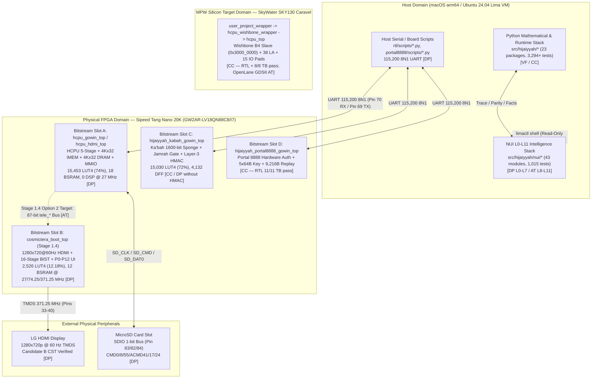
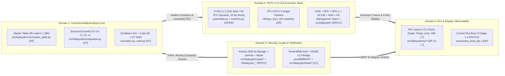

# COSMICTERA — MASTER SYSTEM ARCHITECTURE DESIGN (`CT-01-REV13`)

> **REVISION NOTICE (`v1.2 — K-01..K-12, R2, CTHETA=0x4E / HDOT=0x52 & GAP-02 Final Edition`):**  
> Paket dokumentasi arsitektur versi `v1.0` sebelumnya dinyatakan **`SUPERSEDED` (Tidak Berlaku sebagai Referensi Rekayasa)** sesuai Keputusan Pemilik (*Owner Architecture Consistency Decision*). Edisi `v1.2` ini menerapkan: (1) definisi resmi label epistemik `R2` dari `cosmictera/RULES.md` (`VF` = *Verified Formally*, `CC` = *Computationally Confirmed*, `DP` = *Design Property*, `EH` = *Engineering Hypothesis*, `AT` = *Aspirational Target*), (2) koreksi penuh `K-01` s.d. `K-12` terhadap `rtl/hcpu_pkg.vh`, `rtl/hcpu_rom.v`, `rtl/hcpu_regfile.v`, `rtl/hcpu_mmio.v`, dan `docs/HISA_SPEC.md`, (3) penetapan resmi `0x4E = CTHETA` (ekstraksi $\hat{\Theta}(H[\text{S1}])$ 8-bit, 1 siklus) dan `0x52 = HDOT` (perkalian titik 14-komponen $\langle H[\text{S1}], H[\text{S2}] \rangle_{14}$ 20-bit, 14 siklus pada `CODEX_PROFILE=2` / 1 siklus pada `CODEX_PROFILE=0,1`; total `105` opcode H-ISA v1.2, `84` di RTL, `21` software-only, `375/375` `test_isa_parity.py` PASS), serta (4) penyelesaian `GAP-02` pada `rtl/hcpu_hisab.v` yang kini menginstansiasi `rtl/hcpu_guard.v` secara kanonik (`R1`).

## FULL ECOSYSTEM RECONSTRUCTION FROM REPOSITORY SOURCE OF TRUTH

**Repository:** `/Users/AMRA/hijaiyyah-mathematics/`  
**Verified Baseline Commit:** `HEAD = 8c70989bec0d3b86ace8b657fd8f1d761164b8e3`  
**Audit & Design Mode:** 100% Source-Traceable, Read-Only Repository Forensics (`0` modified tracked files)  
**Canonical Governance:** `AGENTS.md`, `cosmictera/RULES.md` (`R1–R6`), `COSMICTERA_CT01_REV13_AUDIT.md`, `cosmictera/SYSTEM.md`, `cosmictera/COMPUTING.md`, `teknologi/ISTILAH.md`, `docs/ARCHITECTURE.md`, `docs/HISA_SPEC.md`, `cosmictera-build/{ROADMAP,ON,OFF,CHECKLIST,PAPAN}.md`, `NUI/LAYERS.md`.

---

## 1. Definisi Sistem & Konteks Ekosistem (`System Definition`)

**CosmicTera (`CT-01-REV13`)** adalah ekosistem komputasi perangkat keras dan perangkat lunak terpadu berbasis struktur matematika **28 huruf Hijaiyyah** dan **vektor kodeks Hybit 18-dimensi (`18D`)**, yang membentang dari invarian aljabar tersegel (`Master Table`), delapan mesin aljabar `Codex`, primitif kriptografi (`Ka'bah`, `Jamrah`, `Hijrah`, `Portal 8888`), arsitektur set instruksi `H-ISA v1.2` (`105` opcode, `84` RTL / `21` SW), prosesor pipa 5-tahap `HCPU` dalam Verilog RTL, sistem operasi mikro `HOS`, sistem berkas `HFS`, bahasa pemrograman `HC` (*Hybit Code*), lapisan kecerdasan deterministik 12-lapis `NUI` (*Natural Universal Intelligence*), hingga subsistem tampilan boot HDMI `1280×720 @ 60 Hz` pada FPGA **Sipeed Tang Nano 20K (`GW2AR-LV18QN88C8/I7`)** dan pembungkus silikon MPW **SkyWater SKY130 Caravel**.

### Diagram Konteks Master (`01_cosmictera_master_system_context`)

---

## 2. Empat Domain Arsitektur Utama & Batas Epistemik (`02_four_architecture_domains`)

Seluruh komponen di dalam repositori terbagi secara tegas ke dalam **empat domain arsitektural** yang dihubungkan oleh kontrak data deterministik dan dilabeli menggunakan **lima label epistemik resmi (`cosmictera/RULES.md` R2)**:
- **`VF` (*Verified Formally*)**: Terbukti secara matematis/alkhwarizmi di Python dan tersegel dengan pengujian otomatis.
- **`DP` (*Design Property*)**: Terbukti berjalan secara fisik pada papan FPGA Tang Nano 20K atau VM host terisolasi dengan bukti terukur.
- **`CC` (*Computationally Confirmed*)**: Implementasi RTL atau Python selesai dan lulus testbench/pytest, namun belum dijalankan sebagai konfigurasi fisik permanen di papan.
- **`EH` (*Engineering Hypothesis*)**: Eksperimen perangkat keras yang memiliki kendala fisik nyata (mis. `hijaiyyah_kabah_top.v` mentah dengan `1.665` bit port yang melampaui `384` IOB paket FPGA).
- **`AT` (*Aspirational Target*)**: Rancangan arsitektur atau sasaran peta jalan yang belum diimplementasikan.

---

## 3. Sintesis Arsitektur 13-Lapis `CT-01-REV13`

| Lapis `CT-01-REV13` | Komponen Inti | Artefak Sumber Utama | Bukti Verifikasi Terukur | Label |
| :--- | :--- | :--- | :--- | :---: |
| **L1: Fondasi Huruf & Vektor 18D** | 28 Huruf Hijaiyyah, Vektor 18D (`144-bit`), Unifikasi Alamat Atomik | `src/hijaiyyah/core/master_table.py`, `src/hijaiyyah/nui/atom.py`, `rtl/hcpu_rom.v` | Segel SHA-256 Master Table; paritas 100% Python ↔ ROM Verilog (`test_nui_atom.py`) | `VF` |
| **L2: Invarian Guard & Gerbang Mod-4** | Guard `G1–G4`, Topologi `T1–T2`, `H* = Ka <= Theta/2`, Gerbang $\hat{\Theta} \bmod 4$ | `src/hijaiyyah/core/guards.py`, `rtl/hcpu_guard.v` | Kombinasional 1-siklus di RTL; menghasilkan `guard_pass`, `U`, dan $\rho$ bertanda 32-bit | `VF` / `DP` |
| **L3: Eksomatriks 5×5 & Kubus 3D** | Operator biner $5\times 5$ atas $\mathbb{F}_2/\mathbb{F}_5$, Kubus 27-sel, Pohon Wallace | `src/hijaiyyah/core/{exomatrix,wallace,manifold}.py`, `src/hijaiyyah/crypto/cube.py` | Teruji penuh di `tests/test_core/` dan `tests/test_crypto/` | `VF` |
| **L4: Delapan Mesin Aljabar Codex** | `Codex JIM`, `YA`, `WAU`, `'AYIN`, `ALIF`, `BA`, `DAL`, `ZAY` | `src/hijaiyyah/codex/*.py`, `rtl/programs/codex_*.hasm` | 8 modul Python + 8 program `.hasm` dieksekusi di `HISAMachine` dan RTL HCPU | `VF` / `DP` |
| **L5: Kriptografi Ka'bah, Jamrah & Hijrah** | Spons `Ka'bah` 1600-bit (24 putaran), Gerbang 3-tahap `Jamrah`, Jalan `Hijrah`, Layer-3 `HMAC-SHA256` | `src/hijaiyyah/crypto/{kabah,jamrah,hijrah}.py`, `rtl/hijaiyyah_*.v`, `rtl/fpga/gowin/hijaiyyah_kabah_gowin_top.v` | `jamrah_board.py`, `hijrah_board.py`, `kabah_board.py` diuji di Tang Nano 20K; `KABAH_WITH_HMAC` `15.030` LUT4 (`72%`) | `DP` / `CC` / `EH` |
| **L6: Jembatan Audit HISAB & Portal 8888** | Frame `HISAB` 14-byte (`HPACK`, `HCRC` CRC32), `Portal 8888` (`SHA-256` + `HMAC` + 5×64B Key + 9KB Replay Buffer) | `src/hijaiyyah/hisab/`, `rtl/hcpu_hisab.v`, `portal8888/rtl/hijaiyyah_portal8888.v` | `hcpu_hisab.v` di dalam HCPU (`DP`); Portal 8888 lulus `11/11` testbench (`CC`) | `DP` / `CC` |
| **L7: Set Instruksi H-ISA v1.2** | `103` Opcode dalam 8 keluarga, kata instruksi 32-bit, Assembler 2-pass, `HISAMachine` | `docs/HISA_SPEC.md`, `src/hijaiyyah/hisa/{opcodes,assembler,machine}.py` | `74` opcode terbukti langsung di silikon papan (`P3`), `84` diimplementasikan di RTL, `105` opcode didukung interpreter/assembler | `VF` / `DP` |
| **L8: Prosesor HCPU 5-Tahap & Co-Engines** | Pipa `IF-ID-EX-MEM-WB`, `18` GPR (`32b`), `16` H-Reg (`144b`), Forwarding, `hcpu_codex_alu` (3 profil), Trap, MMIO, SDIO | `rtl/hcpu_top.v` + `19` modul `rtl/hcpu_*.v`, `rtl/fpga/gowin/hcpu_gowin_top.v` | Paket 8 (`USE_DSP=0`): `15.453` LUT4 (`74%`), `5.166` DFF (`33%`), `18` BSRAM (`39%`), `0` DSP, `Fmax = 120,63` MHz; burn-in 72 jam lulus | `DP` |
| **L9: Sistem Operasi HOS, HFS, HPG-1, HCVM & HAR** | Mikrokernel `HOS`, sistem berkas `HFS`, kontainer `HAR`, grafika `HPG-1`, mesin virtual `HCVM` | `src/hijaiyyah/{hos,hfs,har,hpg1,hcvm}/`, `rtl/programs/{loader,boot_sd,kernel,hos,shell,hfs_sd,hpg1_scene,hcvm}.hasm` | `loader.hasm` & `boot_sd.hasm` terbukti di papan (`DP`); `kernel.hasm` & `hos.hasm` teruji trap/scheduler (`DP`/`CC`) | `DP` / `CC` |
| **L10: Bahasa Komputasi HC & Compiler** | Lexer, Parser, Evaluator, dan Compiler `HC` -> `H-ISA` | `src/hijaiyyah/language/`, `src/hijaiyyah/compiler/codegen.py` | Kompilasi deterministik `.hc` -> `.hasm` -> `.hex` (`CC`) | `CC` |
| **L11: Kecerdasan Komputasi NUI (L0–L11)** | Fakta (`L0`), Graf Repo (`L1`), Program (`L2`), Jejak (`L3`), Paritas (`L4`), Linux Lima (`L5`), Hardware (`L6`), Otonom (`L7`), KB (`L9`), USR | `src/hijaiyyah/nui/*.py` (`43` modul), `NUI/LAYERS.md`, `NUI/spec/*.json` | `1.015` tes `tests/test_ai/` + `10` tes `test_facts.py` lulus 100% | `DP` (L0–L7, KB L9) / `AT` (L8, L9 inf, L10–L11) |
| **L12: Subsistem Tampilan HDMI 720p & Telemetri** | `cosmictera_boot_top.v` (Stage 1.4), `cosmictera_display_top.v`, `hcpu_hdmi_top.v`, 3 Logo BSRAM, `P0–P12` | `/tmp/stage1_2_cosmictera_boot_ui/rtl/cosmictera_boot_*.v`, `rtl/fpga/gowin/*` | `2.526` LUT4 (`12,18%`), `12` BSRAM (`26,09%`), `84,53` MHz Fmax; diverifikasi fisik pada TV LG (`DP`) | `DP` |
| **L13: Target Silikon MPW Sky130 & Kuantum** | `user_project_wrapper.v`, `hcpu_wishbone_wrapper.v` (`0x3000_0000`), `quantum/` (`QT-4/5/6`) | `rtl/mpw/`, `src/hijaiyyah/quantum/` | `tb_wishbone_wrapper.v` (`8/8` PASS, `CC`); GDSII tapeout fisik masih `AT` | `CC` / `AT` |

---

## 4. Indeks Paket Dokumentasi Arsitektur (`14` Dokumen + `14` Diagram)

Seluruh rekonstruksi arsitektur ini dibagi ke dalam dokumen-dokumen spesialis berikut (tersedia di `/Users/AMRA/hijaiyyah-mathematics/docs/architecture_ct01_rev13/` dan di root `/Users/AMRA/hijaiyyah-mathematics/`):

1. [`COSMICTERA_MASTER_SYSTEM_ARCHITECTURE_CT01_REV13.md`](COSMICTERA_MASTER_SYSTEM_ARCHITECTURE_CT01_REV13.md) — Dokumen Induk Arsitektur Sistem `CT-01-REV13`.
2. [`COSMICTERA_COMPONENT_INVENTORY.md`](COSMICTERA_COMPONENT_INVENTORY.md) — Inventaris lengkap komponen repositori Kategori `A` s.d. `T`.
3. [`COSMICTERA_LAYER_RECONCILIATION.md`](COSMICTERA_LAYER_RECONCILIATION.md) — Rekonsiliasi eksak antara 11-Lapis Kanonik, 13-Lapis `CT-01-REV13`, 12-Lapis NUI, dan `P0–P12` Boot Display.
4. [`COSMICTERA_MATHEMATICAL_FOUNDATION.md`](COSMICTERA_MATHEMATICAL_FOUNDATION.md) — Arsitektur Master Table 28×18D, Guard `G1–G4`/`T1–T2`/`H*`, Eksomatriks 5×5, Kubus 3D, dan 8 Mesin Codex.
5. [`COSMICTERA_HCPU_HISA_ARCHITECTURE.md`](COSMICTERA_HCPU_HISA_ARCHITECTURE.md) — Arsitektur H-ISA v1.2 (`105` opcode, `84` RTL / `21` SW) dan prosesor pipa 5-tahap HCPU beserta 3 profil `hcpu_codex_alu`.
6. [`COSMICTERA_SOFTWARE_RUNTIME_ARCHITECTURE.md`](COSMICTERA_SOFTWARE_RUNTIME_ARCHITECTURE.md) — Arsitektur HOS, HFS, HAR, HPG-1, HCVM, bahasa HC, compiler, dan dua mesin virtual Python (`HISAMachine` & `HVM`).
7. [`COSMICTERA_NUI_ARCHITECTURE.md`](COSMICTERA_NUI_ARCHITECTURE.md) — Arsitektur 12-Lapis NUI (`L0–L11`), spesifikasi semantik USR, dan kontrak operasi otonom *fail-closed*.
8. [`COSMICTERA_HARDWARE_ARCHITECTURE.md`](COSMICTERA_HARDWARE_ARCHITECTURE.md) — Arsitektur perangkat keras FPGA Gowin Tang Nano 20K (6 top-level wrapper, domain clock, anggaran LUT/BSRAM, CST Candidate B) dan Caravel Sky130 MPW.
9. [`COSMICTERA_SECURITY_VERIFICATION_ARCHITECTURE.md`](COSMICTERA_SECURITY_VERIFICATION_ARCHITECTURE.md) — Arsitektur keamanan berlapis: Guard perangkat keras, Jamrah 3-tahap, spons Ka'bah 1600-bit, Layer-3 HMAC-SHA256, dan Portal 8888.
10. [`COSMICTERA_SYSTEM_DATA_FLOW.md`](COSMICTERA_SYSTEM_DATA_FLOW.md) — Delapan aliran data dan kontrol ujung-ke-ujung dari derivasi matematis hingga tampilan HDMI dan keputusan NUI Lapis 7.
11. [`COSMICTERA_INTERFACE_MATRIX.md`](COSMICTERA_INTERFACE_MATRIX.md) — Matriks antarmuka perangkat keras dan perangkat lunak lengkap (nama sinyal, lebar bit, arah, domain clock, protokol, dan pemetaan pin fisik).
12. [`COSMICTERA_TRACEABILITY_MATRIX.md`](COSMICTERA_TRACEABILITY_MATRIX.md) — Matriks ketertelusuran 100% dari setiap klaim arsitektur ke berkas sumber, baris kode, testbench, dan bukti papan.
13. [`COSMICTERA_ARCHITECTURE_GAPS_AND_CONFLICTS.md`](COSMICTERA_ARCHITECTURE_GAPS_AND_CONFLICTS.md) — Daftar lengkap celah arsitektur, ketidaksesuaian antar-modul, bug perangkat keras yang terdokumentasi di `OFF.md`, dan batas anggaran sumber daya FPGA.
14. [`COSMICTERA_ARCHITECTURE_SOURCE_MANIFEST.txt`](COSMICTERA_ARCHITECTURE_SOURCE_MANIFEST.txt) — Manifes SHA-256 seluruh berkas sumber kanonik dan seluruh artefak dokumentasi/diagram yang dihasilkan.

---

## Lampiran Verifikasi Forensik `v1.2`: Matriks Kebenaran Kanonik `K-01` s.d. `K-12` (`rtl/hcpu_pkg.vh`, `rtl/hcpu_rom.v`, `rtl/hcpu_mmio.v`, `docs/HISA_SPEC.md`)

Tabel berikut mengunci parameter perangkat keras dan encoding instruksi aktual langsung dari berkas RTL kanonik (`rtl/hcpu_pkg.vh`, `rtl/hcpu_rom.v`, `rtl/hcpu_regfile.v`, `rtl/hcpu_execute.v`, `rtl/hcpu_memory.v`, `rtl/hcpu_mmio.v`, `rtl/hcpu_trap.v`):

| Kode Koreksi | Domain Arsitektur | Spesifikasi Eksak di Sumber Kanonik (`rtl/` & `docs/HISA_SPEC.md`) |
| :--- | :--- | :--- |
| **`K-01`** | **Opcode Huruf Hijaiyyah (`28` Huruf)** | **`0xE0–0xFB`** (`OP_L_ALIF = 8'hE0` s.d. `OP_L_YA = 8'hFB` di `rtl/hcpu_pkg.vh` baris 195–222; `OpCode.L_ALIF..OpCode.L_YA` di `opcodes.py`). Alamat ROM dihitung sebagai `id_opcode - OP_L_ALIF + 1` (`1..28`, 1-based). |
| **`K-02`** | **Opcode Sistem & Kontrol (`0x00–0x0B`)** | `NOP = 0x00`, `HALT = 0x01`, `MOV = 0x03`, `MOVI = 0x04`, `HNRM2 = 0x06`, `HDIST = 0x07`, `ERET = 0x08`, `SYSCALL = 0x09`, `FRD = 0x0A`, `FWR = 0x0B` (`rtl/hcpu_pkg.vh` baris 129–139). (`RESET = 0x02` dan `WAIT = 0x05` hanya di perangkat lunak). |
| **`K-03`** | **Opcode Aritmetika (`0x10–0x14`) & Bitwise (`0xB0–0xBA`)** | **Aritmetika RTL**: `ADD = 0x10`, `ADDI = 0x11`, `SUB = 0x12`, `MUL = 0x14` (`SUBI=0x13`, `DIV=0x15`, `MOD=0x16`, `NEG=0x17`, `INC=0x18`, `DEC=0x19` hanya di perangkat lunak). **Bitwise/Shift RTL**: `AND = 0xB0`, `OR = 0xB1`, `XOR = 0xB2`, `NOT = 0xB3`, `SHL = 0xB4`, `SHR = 0xB5`, `ANDI = 0xB6`, `ORI = 0xB7`, `XORI = 0xB8`, `SHLI = 0xB9`, `SHRI = 0xBA` (`rtl/hcpu_pkg.vh` baris 142–145 & 225–235). |
| **`K-04`** | **Opcode Compare, Branch & Call (`0x20–0x2F`)** | **RTL**: `CMP = 0x20`, `CMPI = 0x21`, `JMP = 0x22`, `JEQ = 0x23`, `JNE = 0x24`, `JGD = 0x29` (cabang jika `FLAG_G == 1`), `JNGD = 0x2A` (cabang jika `FLAG_G == 0`), `CALL = 0x2E`, `RET = 0x2F` (`rtl/hcpu_pkg.vh` baris 148–156). (`JGT=0x25`, `JLT=0x26`, `JGE=0x27`, `JLE=0x28`, `JOVF=0x2B`, `JNOVF=0x2C`, `JRHO=0x2D` hanya di perangkat lunak; tidak ada `JMOD4` di RTL). |
| **`K-05`** | **Opcode Memori & Stack (`0x30–0x33`) & Kedalaman Stack** | **RTL**: `LOAD = 0x30`, `STORE = 0x31`, `PUSH = 0x32`, `POP = 0x33` (`rtl/hcpu_pkg.vh` baris 159–162; `LOADH=0x38`, `STOREH=0x39`, `LPUSH=0x3A`, `LPOP=0x3B` hanya di perangkat lunak). **Return Address Stack (`CALL`/`RET`)**: `RA_DEPTH = 32` (`32 × 12-bit` di `rtl/hcpu_execute.v` baris 121). **Data Stack (`PUSH`/`POP`)**: `STACK_DEPTH = 256` (`256 × 32-bit` di `rtl/hcpu_memory.v` baris 81). |
| **`K-06`** | **Opcode Codex, Guard & HISAB (`0x40–0x60`)** | **RTL**: `HLOAD = 0x40`, `HCADD = 0x42`, `CGET = 0x44`, `CSET = 0x45`, `CMOV = 0x46`, `CZERO = 0x47`, `CEQ = 0x48`, `CRHO = 0x4C`, `CU = 0x4D`, **`CTHETA = 0x4E`** (`OP_CTHETA = 8'h4E`, ekstraksi $\hat{\Theta}(H[\text{S1}])$ 8-bit, 1 siklus), `CMOD4 = 0x4F`, `HPACK = 0x50`, `HCRC = 0x51`, **`HDOT = 0x52`** (`OP_HDOT = 8'h52`, produk dalam 14-komponen 20-bit via `ALU_HDOT`, 14 siklus pada `CODEX_PROFILE=2`), `HGRD = 0x60` (`HCHK = 0x68` hanya di perangkat lunak). |
| **`K-07`** | **Opcode I/O & Error (`0xA0–0xFF`) & Total Opcode** | **RTL**: `PRINT = 0xA0`, `EMITS = 0xA2`, `HALT_ERR = 0xFF` (`PRINTH = 0xA1` dan `DUMP = 0xA8` hanya di perangkat lunak). **Total Opcode**: **`105` opcode unik** di `docs/HISA_SPEC.md` dan `OpCode` di `src/hijaiyyah/hisa/opcodes.py` (`0` alias); **`84` diimplementasikan di RTL** (`rtl/hcpu_pkg.vh` & `RTL_IMPLEMENTED`, termasuk `28` opcode huruf `0xE0–0xFB`, `CTHETA = 0x4E`, dan `HDOT = 0x52`) serta **`21` software-only** (`cosmictera-build/OFF.md`). |
| **`K-08`** | **Pemetaan Bit `FLAGS` (`rtl/hcpu_pkg.vh` baris 56–59)** | `FLAG_G = 0` (`bit 0`: Guard pass), `FLAG_Z = 1` (`bit 1`: Zero), `FLAG_O = 2` (`bit 2`: Overflow), `FLAG_LT = 3` (`bit 3`: Less-than). |
| **`K-09`** | **Struktur `rtl/hcpu_rom.v` (`ROM_ADDR_W = 6`)** | Alamat **6-bit (`addr[5:0]`, `0..63`)**: indeks **`1..28`** adalah 28 huruf Hijaiyyah kanonik (1-based: `1 = Alif` .. `28 = Ya`); indeks **`31..36`** adalah **6 vektor uji negatif** untuk verifikasi perangkat keras (`31` gagal `G4`, `32` gagal `G1`, `33` gagal `G2`, `34` gagal `G3`, `35` gagal `T1`, `36` gagal `T2`); indeks `0`, `29`, `30`, `37..63` mengembalikan `valid = 0` dan `144'd0`. Total entri valid = `34` (`28 + 6`). |
| **`K-10`** | **Peta MMIO Blok SDIO (`0xFE0–0xFE6`)** | `0xFE0 = SD_CMD` (W: `1`=INIT, `2`=READ, `3`=WRITE), `0xFE1 = SD_STATUS` (R: `{24'd0, err_code[3:0], card_ready, err, ok, busy}`), `0xFE2 = SD_SECTOR` (RW: 32-bit LBA), `0xFE3 = SD_DATA` (RW: 128-word buffer port, auto-inc `sd_index`), `0xFE4 = SD_CONTROL` (RW: bit 0 reset index, bit 1 soft reset, bits `[3:2]` clock div), `0xFE5 = SD_CSUM` (R: XOR checksum), `0xFE6 = SD_PRESCAN` (R: `{30'd0, all_zero, has_magic}`). `0xFE7–0xFEF` tidak terpakai (`0`). |
| **`K-11`** | **Peta MMIO Blok Inti (`0xFF0–0xFFF`), Trap & Privilege** | `0xFF0 = REG_RX_DATA`, `0xFF1 = REG_RX_STATUS`, `0xFF2 = REG_TX_STATUS`, **`0xFF3 = REG_IMEM_ADDR`**, `0xFF4 = REG_COUNTER`, `0xFF5 = REG_COMPARE`, `0xFF6 = REG_TIMER_ST`, **`0xFF7 = REG_IMEM_DATA`**, `0xFF8 = REG_TRAP_VECTOR`, `0xFF9 = REG_TRAP_EPC`, `0xFFA = REG_TRAP_CAUSE` (**`0`=Timer, `1`=UART_RX, `2`=Illegal, `3`=Priv, `4`=Mem, `5`=Syscall**), `0xFFB = REG_TRAP_ENABLE`, `0xFFC = REG_TRAP_PENDING`, `0xFFD = REG_TRAP_MODE` (**`MODE_USER = 0`, `MODE_SUPER = 1`** di `hcpu_pkg.vh`; bit `[1]` di `hcpu_trap.v` mengaktifkan proteksi User), **`0xFFE = REG_MEM_BASE`**, **`0xFFF = REG_MEM_LIMIT`**. |
| **`K-12`** | **Bank Register (`hcpu_regfile.v`) & Model Lapisan** | **GPR**: `GPR_COUNT = 18` (`R0–R17` × 32-bit fisik di `hcpu_regfile.v`, sedangkan field instruksi 4-bit mengalamati `R0–R15`). **H-Reg**: `HREG_COUNT = 16` (`H0–H15` × `144-bit` + `hreg_ovf[15:0]` di `hcpu_regfile.v`; berbeda dari tabel warisan `HISA_SPEC.md` §3.2 yang mencantumkan `4` `H0–H3` × `576-bit`). **Model Lapisan**: membedakan secara eksplisit (a) **5-Lapis Keamanan Ka'bah** (`cosmictera/RULES.md` R10: L0 Kanonik `DP`, L1 Guard `CC`, L2 Serapan `EH`, L3 Autentik `VF`, L4 Rahasia ditolak), (b) **7-Lapis `cosmictera/SYSTEM.md`**, (c) **11-Lapis `docs/ARCHITECTURE.md`**, (d) **12-Lapis `NUI/LAYERS.md` (`L0–L11`)**, dan (e) **13-Lapis `COSMICTERA_CT01_REV13_AUDIT.md`**. |
