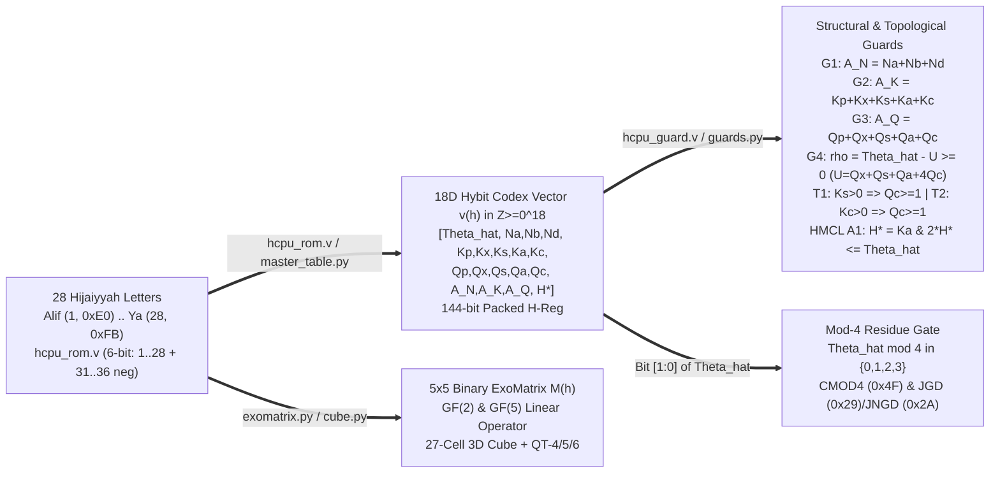

# COSMICTERA — MATHEMATICAL FOUNDATION ARCHITECTURE (`CT-01-REV13`)

> **REVISION NOTICE (`v1.2 — K-01..K-12, R2, CTHETA=0x4E / HDOT=0x52 & GAP-02 Final Edition`):**  
> Paket dokumentasi arsitektur versi `v1.0` sebelumnya dinyatakan **`SUPERSEDED` (Tidak Berlaku sebagai Referensi Rekayasa)** sesuai Keputusan Pemilik (*Owner Architecture Consistency Decision*). Edisi `v1.2` ini menerapkan: (1) definisi resmi label epistemik `R2` dari `cosmictera/RULES.md` (`VF` = *Verified Formally*, `CC` = *Computationally Confirmed*, `DP` = *Design Property*, `EH` = *Engineering Hypothesis*, `AT` = *Aspirational Target*), (2) koreksi penuh `K-01` s.d. `K-12` terhadap `rtl/hcpu_pkg.vh`, `rtl/hcpu_rom.v`, `rtl/hcpu_regfile.v`, `rtl/hcpu_mmio.v`, dan `docs/HISA_SPEC.md`, (3) penetapan resmi `0x4E = CTHETA` (ekstraksi $\hat{\Theta}(H[\text{S1}])$ 8-bit, 1 siklus) dan `0x52 = HDOT` (perkalian titik 14-komponen $\langle H[\text{S1}], H[\text{S2}] \rangle_{14}$ 20-bit, 14 siklus pada `CODEX_PROFILE=2` / 1 siklus pada `CODEX_PROFILE=0,1`; total `105` opcode H-ISA v1.2, `84` di RTL, `21` software-only, `375/375` `test_isa_parity.py` PASS), serta (4) penyelesaian `GAP-02` pada `rtl/hcpu_hisab.v` yang kini menginstansiasi `rtl/hcpu_guard.v` secara kanonik (`R1`).

**Canonical Sources:** `src/hijaiyyah/core/master_table.py`, `src/hijaiyyah/core/guards.py`, `src/hijaiyyah/core/exomatrix.py`, `src/hijaiyyah/crypto/cube.py`, `src/hijaiyyah/nui/atom.py`, `rtl/hcpu_rom.v`, `rtl/hcpu_guard.v`.  
**Epistemic Status:** `VF` (Verified Formally — terbukti secara matematis, tersegel SHA-256, dan diuji silang antara Python serta RTL).

---

## 1. Prinsip Unifikasi Atomik (`src/hijaiyyah/nui/atom.py`)

Di seluruh ekosistem CosmicTera, **28 huruf Hijaiyyah** (`Alif` indeks `1` (opcode `0xE0`) hingga `Ya` indeks `28` (opcode `0xFB`)) bukan diperlakukan sebagai karakter fonetik atau simbol linguistik (`CONTRIBUTING.md`), melainkan sebagai **28 objek matematis diskrit** yang memiliki satu identitas alamat tunggal di tiga domain sekaligus (`src/hijaiyyah/nui/atom.py`, diverifikasi oleh `test_nui_atom.py`):

$$\text{Indeks Master Table } i \in \{0, \dots, 27\} \;\equiv\; \text{Opcode H-ISA } \mathtt{0x00} + i \;\equiv\; \text{Alamat ROM Perangkat Keras } \mathtt{rom\_addr}[4:0] = i$$

Saat instruksi keluarga `0xE0–0xFB` (`L_ALIF` s.d. `L_YA`) dieksekusi oleh HCPU (`rtl/hcpu_execute.v`), prosesor membaca entri ke-$i$ dari `hcpu_rom.v` dan mengakumulasikannya secara komponen-demi-komponen ke register vektor `H0`:

$$H_0 \leftarrow H_0 \oplus_{18} \mathbf{v}(h_i)$$

---

## 2. Diagram Fondasi Matematika (`04_mathematical_foundation`)

---

## 3. Vektor Kodeks Hybit 18-Dimensi (`src/hijaiyyah/core/master_table.py` & `rtl/hcpu_pkg.vh`)

Setiap huruf $h_i$ dipetakan ke vektor 18 komponen bilangan bulat tak-negatif $\mathbf{v}(h_i) \in \mathbb{Z}_{\ge 0}^{18}$. Dalam perangkat keras (`rtl/hcpu_pkg.vh` baris 21–49), setiap komponen menempati tepat 1 byte tak-bertanda (`8-bit unsigned`), membentuk **144-bit H-Register (`HREG_W = 144`)**:

| Indeks Lane `c[k]` | Bit Slice di `H-Reg` (`144-bit`) | Makro Verilog (`rtl/hcpu_pkg.vh`) | Simbol Matematis | Kelompok Komponen | Peran Struktural |
| :---: | :---: | :--- | :---: | :--- | :--- |
| `0` | `[7:0]` | `` `C_THETA `` | $\hat{\Theta}$ | Kapasitas Sudut / Total | Kapasitas geometris utama; kunci gerbang Mod-4 ($\hat{\Theta} \bmod 4$) |
| `1` | `[15:8]` | `` `C_NA `` | $N_a$ | Keluarga Titik ($N$) | Titik atas (*nuqthah fawq*) |
| `2` | `[23:16]` | `` `C_NB `` | $N_b$ | Keluarga Titik ($N$) | Titik bawah (*nuqthah taht*) |
| `3` | `[31:24]` | `` `C_ND `` | $N_d$ | Keluarga Titik ($N$) | Titik dalam / tengah (*nuqthah dakhil*) |
| `4` | `[39:32]` | `` `C_KP `` | $K_p$ | Keluarga Kelengkungan ($K$) | Segmen kelengkungan primer |
| `5` | `[47:40]` | `` `C_KX `` | $K_x$ | Keluarga Kelengkungan ($K$) | Segmen kelengkungan silang / refleksi |
| `6` | `[55:48]` | `` `C_KS `` | $K_s$ | Keluarga Kelengkungan ($K$) | Segmen kelengkungan sekunder (terikat topologi $T_1$) |
| `7` | `[63:56]` | `` `C_KA `` | $K_a$ | Keluarga Kelengkungan ($K$) | Kelengkungan apeks (identik dengan $H^*$ pada Master Table) |
| `8` | `[71:64]` | `` `C_KC `` | $K_c$ | Keluarga Kelengkungan ($K$) | Kelengkungan tertutup (terikat topologi $T_2$) |
| `9` | `[79:72]` | `` `C_QP `` | $Q_p$ | Keluarga Kuantum/Geometri ($Q$) | Kuantum primer |
| `10` | `[87:80]` | `` `C_QX `` | $Q_x$ | Keluarga Kuantum/Geometri ($Q$) | Kuantum aksial (masuk ke beban potensial $U$) |
| `11` | `[95:88]` | `` `C_QS `` | $Q_s$ | Keluarga Kuantum/Geometri ($Q$) | Kuantum simetri (masuk ke beban potensial $U$) |
| `12` | `[103:96]` | `` `C_QA `` | $Q_a$ | Keluarga Kuantum/Geometri ($Q$) | Kuantum sudut (masuk ke beban potensial $U$) |
| `13` | `[111:104]` | `` `C_QC `` | $Q_c$ | Keluarga Kuantum/Geometri ($Q$) | Kuantum inti/siklus (bobot $4\times$ pada $U$; jangkar $T_1, T_2$) |
| `14` | `[119:112]` | `` `C_AN `` | $A_N$ | Agregat Struktural | Jumlah keluarga titik ($N_a + N_b + N_d$) |
| `15` | `[127:120]` | `` `C_AK `` | $A_K$ | Agregat Struktural | Jumlah keluarga kelengkungan ($K_p + K_x + K_s + K_a + K_c$) |
| `16` | `[135:128]` | `` `C_AQ `` | $A_Q$ | Agregat Struktural | Jumlah keluarga kuantum ($Q_p + Q_x + Q_s + Q_a + Q_c$) |
| `17` | `[143:136]` | `` `C_HSTAR `` | $H^*$ | Invarian Terkopel | Invarian entropi/apeks ($H^* = K_a \le \lfloor \hat{\Theta}/2 \rfloor$) |

> **Catatan Lebar Operasi Vektor (`rtl/hcpu_codex_alu.v`):**
> - Operasi penjumlahan vektor `HCADD` (`0x42`) menjumlahkan **seluruh 18 lane** (`c[0]..c[17]`) secara paralel dan menghasilkan bit `add_ovf` jika salah satu dari 18 lane meluap (`> 255`).
> - Operasi metrik ruang dalam `HNRM2` (`0x06`), `HDIST` (`0x07`), dan operasi `ALU_HDOT` pada `hcpu_codex_alu.v` (terhubung ke opcode publik `HDOT` = `0x52` / `OP_HDOT = 8'h52`, terpisah secara bersih dari `CTHETA` = `0x4E` / `OP_CTHETA = 8'h4E`) beroperasi pada **14 komponen primer pertama** (`c[0]..c[13]`, yaitu $\hat{\Theta}$ hingga $Q_c$) sesuai definisi metrik $\|\cdot\|_{14}^2$ dan $\langle\cdot,\cdot\rangle_{14}$.

---

## 4. Tujuh Invarian Guard (`src/hijaiyyah/core/guards.py` & `rtl/hcpu_guard.v`)

Modul perangkat keras `rtl/hcpu_guard.v` (baris 26–157) merupakan sumber kebenaran tunggal (`R1`) untuk evaluasi kelayakan vektor 144-bit serta penghitungan nilai $U$ dan residu bertanda $\rho$:

1. **Guard Struktural `G1` (`g1_comb`, baris 73–75)**:
   $$A_N = N_a + N_b + N_d$$
   Diimplementasikan dengan penjumlah 10-bit penuh (`wire [9:0] sum_n = na + nb + nd`) agar luapan bit ke-8 tidak pernah teralias menjadi lulus semu.
2. **Guard Struktural `G2` (`g2_comb`, baris 77–79)**:
   $$A_K = K_p + K_x + K_s + K_a + K_c$$
   Diimplementasikan dengan penjumlah 11-bit penuh (`wire [10:0] sum_k`).
3. **Guard Struktural `G3` (`g3_comb`, baris 81–83)**:
   $$A_Q = Q_p + Q_x + Q_s + Q_a + Q_c$$
   Diimplementasikan dengan penjumlah 11-bit penuh (`wire [10:0] sum_q`).
4. **Guard Kapasitas-Potensial `G4` (`g4_comb`, baris 85–99)**:
   $$U = Q_x + Q_s + Q_a + 4 Q_c, \qquad \rho = \hat{\Theta} - U \ge 0$$
   `u_val` dihitung secara eksak melalui penggeseran `({qc, 2'b00})`, sedangkan `rho_signed` dihitung sebagai bilangan bulat bertanda 12-bit (`$signed({4'd0, theta}) - $signed({1'b0, u_val})`) dan diekstensi tanda menjadi 32-bit untuk instruksi `CRHO` (`0x4C`), `CU` (`0x4D`), dan `CMOD4` (`0x4F`).
5. **Guard Topologis `T1` (`t1_comb`, baris 101–102)**:
   $$K_s > 0 \implies Q_c \ge 1$$
6. **Guard Topologis `T2` (`t2_comb`, baris 104–108)**:
   $$K_c > 0 \implies Q_c \ge 1$$
   *(Catatan Forensik: Dalam Master Table kanonik yang telah dikoreksi, huruf Kaf memiliki $K_a=1, K_c=0, Q_c=0$ sehingga memenuhi $T_2$ secara murni di `hcpu_guard.v` tanpa pengecualian khusus. Melalui penyelesaian `GAP-02` yang diotorisasi Pemilik, `rtl/hcpu_hisab.v` kini menginstansiasi `rtl/hcpu_guard.v` (`PIPELINE_GUARD = 0`) secara langsung tanpa duplikasi rumus $U$, penjumlahan 8-bit, ataupun pengecualian warisan `is_kaf`).*
7. **Guard Terkopel `H*` (`hstar_comb`, baris 110–112)**:
   $$H^* = K_a \;\land\; H^* \le \lfloor \hat{\Theta} / 2 \rfloor$$

Keputusan gabungan `guard_pass` adalah konjungsi Boolean dari ketujuh syarat di atas:
`guard_pass_comb = g1_comb & g2_comb & g3_comb & g4_comb & t1_comb & t2_comb & hstar_comb`.

---

## 5. Operator Eksomatriks 5×5, Kubus 3D & Delapan Mesin Codex

1. **Eksomatriks 5×5 (`src/hijaiyyah/core/exomatrix.py`)**:
   Setiap huruf $h_i$ direpresentasikan juga sebagai matriks biner $M(h_i) \in \{0,1\}^{5\times 5}$ di atas lapangan hingga $\mathbb{F}_2$ dan $\mathbb{F}_5$.
   - **Fakta Terverifikasi `nui.tail_one_is_not_invertibility` (`facts/` & `NUI/LAYERS.md` baris 162–167)**: Tujuh huruf dengan bit ekor `1` memiliki rank di bawah `5` atas $\mathbb{F}_2$, sehingga bit ekor `1` **bukan** syarat cukup invertibilitas matriks.
2. **Kubus Kriptografi 27-Sel (`src/hijaiyyah/crypto/cube.py`)**:
   Memetakan 27 huruf pertama ke kisi ruang $3\times 3\times 3$ dan huruf ke-28 sebagai elemen pusat/transisi, menjadi dasar rotasi spasial dan dinamika **Codex WAU**.
3. **Delapan Mesin Aljabar Codex (`src/hijaiyyah/codex/`)**:
   - **Codex JIM (`jim.py`)**: Struktur grup linier $\text{GL}(5, \mathbb{F}_2)$, orbit, dan periode matriks huruf.
   - **Codex YA (`ya.py`)**: Aritmetika lapangan hingga $\mathbb{F}_{2^5} \cong \mathbb{F}_2[x]/(x^5 + x^2 + 1)$.
   - **Codex WAU (`wau.py`)**: Dinamika lintasan keadaan pada ruang 27-sel.
   - **Codex 'AYIN (`ayin.py`)**: Struktur insidensi bidang proyektif $\text{PG}(2, \mathbb{F}_5)$ dengan $5^2 + 5 + 1 = 31$ titik dan $31$ garis.
   - **Codex ALIF (`alif.py`)**: Nilai eigen, trace, dan spektrum operator huruf.
   - **Codex BA (`ba.py`)**: Entropi informasi dan distribusi bobot Hamming/vektor 18D.
   - **Codex DAL (`dal.py`)**: Matriks ketetanggaan dan Laplacian graf 28-simpul.
   - **Codex ZAY (`zay.py`)**: Tabel distribusi diferensial (DDT), aproksimasi linier (LAT), dan pohon reduksi Wallace (`src/hijaiyyah/core/wallace.py`).
