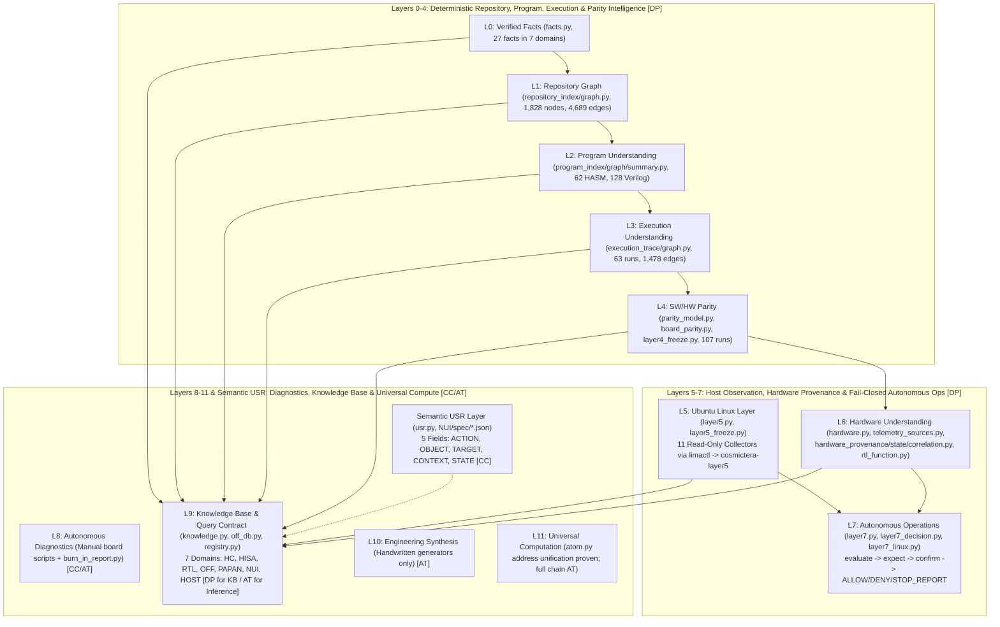

# COSMICTERA — NUI (NATURAL UNIVERSAL INTELLIGENCE) ARCHITECTURE (`CT-01-REV13`)

> **REVISION NOTICE (`v1.2 — K-01..K-12, R2, CTHETA=0x4E / HDOT=0x52 & GAP-02 Final Edition`):**  
> Paket dokumentasi arsitektur versi `v1.0` sebelumnya dinyatakan **`SUPERSEDED` (Tidak Berlaku sebagai Referensi Rekayasa)** sesuai Keputusan Pemilik (*Owner Architecture Consistency Decision*). Edisi `v1.2` ini menerapkan: (1) definisi resmi label epistemik `R2` dari `cosmictera/RULES.md` (`VF` = *Verified Formally*, `CC` = *Computationally Confirmed*, `DP` = *Design Property*, `EH` = *Engineering Hypothesis*, `AT` = *Aspirational Target*), (2) koreksi penuh `K-01` s.d. `K-12` terhadap `rtl/hcpu_pkg.vh`, `rtl/hcpu_rom.v`, `rtl/hcpu_regfile.v`, `rtl/hcpu_mmio.v`, dan `docs/HISA_SPEC.md`, (3) penetapan resmi `0x4E = CTHETA` (ekstraksi $\hat{\Theta}(H[\text{S1}])$ 8-bit, 1 siklus) dan `0x52 = HDOT` (perkalian titik 14-komponen $\langle H[\text{S1}], H[\text{S2}] \rangle_{14}$ 20-bit, 14 siklus pada `CODEX_PROFILE=2` / 1 siklus pada `CODEX_PROFILE=0,1`; total `105` opcode H-ISA v1.2, `84` di RTL, `21` software-only, `375/375` `test_isa_parity.py` PASS), serta (4) penyelesaian `GAP-02` pada `rtl/hcpu_hisab.v` yang kini menginstansiasi `rtl/hcpu_guard.v` secara kanonik (`R1`).

**Canonical Sources:** `NUI/LAYERS.md`, `NUI/ROADMAP.md`, `NUI/SEMANTIK.md`, `NUI/GRAPH.md`, `NUI/PROGRAMS.md`, `NUI/EXECUTION.md`, `NUI/PARITY.md`, `NUI/HARDWARE.md`, `NUI/TELEMETRY_SOURCES.md`, `NUI/HARDWARE_PROVENANCE.md`, `NUI/LAYER7.md`, `NUI/pipeline.py`, `src/hijaiyyah/nui/*.py` (`43` modul), `facts/` (`27` fakta).  
**Test Verification:** `1.015` tes lulus di `tests/test_ai/` + `10` tes di `tests/test_integrity/test_facts.py`.  
**Core Governance Mandate (`NUI/LAYERS.md` baris 3–16):** NUI adalah lapisan kecerdasan komputasi deterministik yang memahami dan mengoperasikan ekosistem CosmicTera dari huruf hingga silikon — **bukan chatbot, bukan pembungkus LLM, dan tidak pernah mengklaim AGI atau kesadaran**.

---

## 1. Diagram Arsitektur 12-Lapis NUI (`08_nui_internal_architecture`)

---

## 2. Spesifikasi Lapis demi Lapis (`Lapis 0` s.d. `Lapis 11`)

### Lapis 0 — Pengetahuan Terverifikasi (`src/hijaiyyah/nui/facts.py` & `facts/`)
- **Status**: `DP` (`10` tes di `test_facts.py`).
- **Arsitektur**: Memuat `27` fakta terstruktur di `7` domain dengan tiga mekanisme verifikasi otomatis:
  1. `derive` (`10` fakta): dihitung ulang secara matematis dari kode sumber setiap kali tes berjalan.
  2. `pytest` (`9` fakta): ditautkan ke node pengujian pytest spesifik yang wajib ada dan lulus.
  3. `board` (`8` fakta): hasil pengukuran fisik papan Tang Nano 20K (termasuk 5 fakta dari burn-in 72 jam yang selesai 21 September 2026) disertai perintah reproduksinya.
- **Temuan Kritis di Lapis 0**: Fakta ke-27 (`nui.tail_one_is_not_invertibility`) mendokumentasikan secara jujur bahwa bit ekor `1` pada Eksomatriks 5×5 tidak menjamin invertibilitas atas $\mathbb{F}_2$ (7 huruf berekor 1 memiliki rank `< 5`).

### Lapis 1 — Pemahaman Repositori (`repository_index.py` & `repository_graph.py`)
- **Status**: `DP` (`13` tes di `test_nui_repository_graph.py`).
- **Arsitektur**: Mengindeks seluruh pohon Git (`git ls-files`, termasuk `93` berkas Markdown terlacak dan `875` definisi tingkat atas di `src/`) menjadi graf berarah dengan **`1.828` node dan `4.689` edge** dari 5 relasi: `imports`, `mentions`, `references`, `verifies`, dan `defines`. Setiap edge diverifikasi menunjuk tepat ke nomor baris yang memuat pernyataan tersebut.

### Lapis 2 — Pemahaman Program (`program_index.py`, `program_graph.py`, `program_summary.py`)
- **Status**: `DP` (`10` tes di `test_nui_program_index.py`).
- **Arsitektur**: Mengurai **`62` program `.hasm`**, **`1.541` fungsi Python**, dan **`128` modul Verilog**; menyelesaikan **`277` instruksi `CALL` H-ASM** ke label tujuannya dan **`131` instansiasi modul Verilog**; serta menurunkan ringkasan efek register/memori langsung dari badan kode (`loader.hasm` diverifikasi silang terhadap `freeze_load()`).

### Lapis 3 — Pemahaman Eksekusi (`execution_trace.py` & `execution_graph.py`)
- **Status**: `DP` (`26` tes di `test_nui_execution.py`).
- **Arsitektur**: Membungkus `HISAMachine.step()`, `_mem_read`, dan `_mem_write` untuk merekam transisi keadaan `sebelum -> instruksi -> sesudah` pada **`63` eksekusi program** (`62` program `.hasm` + `loader.hasm` dengan payload kabel), menghasilkan **`1.478` edge eksekusi** (`READS`, `OBSERVES`, `WRITES`, `CALLS`, `RESUMES`, dll.) di `NUI/execution_model.json`.
- **Cacat yang Ditemukan & Diperbaiki Lapis 3**: Menemukan bahwa jalur kesalahan `HC-04`/`HC-05` pada `RET` menulis atribut `halted` alih-alih `_halted`, yang sebelumnya membuat interpreter terus berjalan menembus fungsi berikutnya (`412` edge palsu berhasil dibersihkan setelah perbaikan).

### Lapis 4 — Paritas Perangkat Lunak ↔ Perangkat Keras (`parity_model.py`, `board_parity.py`, `board_probes.py`, `layer4_freeze.py`)
- **Status**: `DP` — Dibekukan (`test_nui_parity.py` 25 tes, `test_nui_board_parity.py` 27 tes, `test_nui_layer4_freeze.py` 9 tes).
- **Arsitektur**: Membandingkan jejak langkah-demi-langkah antara interpreter Python, simulasi RTL (`rtl/tb/tb_parity.v` dengan mode `+TRACE`), dan rekaman papan fisik Tang Nano 20K di atas **`107` run** (`41` program paritas di `parity_programs.py`, `62` program `.hasm`, tangga `PRINT` $2^0..2^{31}$, dan `3` probe berhenti):
  - **Interpreter ↔ RTL**: `70` `PARITY`, `30` `MISMATCH` (semuanya terlokalisasi ke langkah, register, dan opcode: `10` instruksi bayangan sesudah `HALT`/`RET` HC-05 di RTL, `3` probe berhenti, `8` pembacaan `COUNTER` instruksi vs clock, `7` `SD_STATUS` tanpa kartu `0` vs `1`, dan `2` `HCHECK` berkala), serta `7` `UNKNOWN`.

### Lapis 5 — Integrasi Linux (`layer5.py` & `layer5_freeze.py`)
- **Status**: `DP` — Dibekukan pada tag `layer5-freeze-2026-09-27-final` (`63` tes di `test_nui_layer5.py` + `10` tes di `test_nui_layer5_freeze.py`).
- **Arsitektur**: Mengoperasikan pagar **hanya-baca (*read-only gate*)** menuju VM Ubuntu Server 24.04 LTS ARM64 (`cosmictera-layer5` dan `cosmictera-layer5-uji`) melalui satu pintu keluar `limactl shell <instance> -- <argv>`. Menjalankan **`11` kolektor observasi** (`NUI/spec/layer5_collectors.json`) dan menyimpan bukti ber-manifest SHA-256 di luar repositori (`~/cosmictera-layer5/observations/<run_id>/`).

### Lapis 6 — Pemahaman Perangkat Keras (`hardware.py`, `telemetry_sources.py`, `hardware_provenance.py`, `hardware_state.py`, `hardware_correlation.py`, `rtl_function.py`, `layer6_freeze.py`, `layer6_addendum.py`)
- **Status**: `DP` — Dibekukan pada tag `layer6-freeze-2026-09-29-final` (`351` tes lintas 15 berkas pengujian Lapis 6).
- **Arsitektur**:
  - **6.1 Inventaris Perangkat Keras (`hardware.py`)**: `34` butir (`19` `MEASURED`, `11` `SIMULATED` termasuk metrik PNR/build-derived K-18, `4` `UNKNOWN`).
  - **6.2 Sumber Telemetri (`telemetry_sources.py`)**: Memetakan `27` medan kontrak `cosmictera/TELEMETRY.md` (`23` `MEASURED` historis via UART, `0` sumber live yang sedang mengalir saat offline, `4` `UNKNOWN`, dan `6` sinyal RTL `tele_*` berstatus `SIMULATED`).
  - **6.3 & 6.4 Provenance & State Model (`hardware_provenance.py`, `hardware_state.py`)**: Memisahkan dimensi `IDENTITY`, `CAPABILITY`, `OBSERVED`, dan `CURRENT` dengan preseden `LIVE > MEASURED > SIMULATED > UNKNOWN` (kueri `CURRENT` tidak pernah jatuh diam-diam ke rekaman historis).
  - **6.5 Korelasi & Fungsi RTL (`hardware_correlation.py`, `rtl_function.py`)**: Memodelkan `hcpu_uart_rx`, `hcpu_mmio`, `hcpu_uart_tx`, `hcpu_dataram`, `loader.hasm`, pipa 4-bundle HCPU, dan integrasi `hcpu_top` sebagai fungsi transisi keadaan deterministik yang dicocokkan siklus-demi-siklus terhadap testbench Verilog.

### Lapis 7 — Operasi Otonom (`layer7.py`, `layer7_decision.py`, `layer7_linux.py`)
- **Status**: `DP` (`155` tes di `test_nui_layer7*.py`).
- **Arsitektur**: Mengimplementasikan kontrak operasi otonom *least-privilege + fail-closed* (`NUI/LAYER7.md`):
  1. `layer7.evaluate()`: Memeriksa 6 prasyarat kontrak 7.6 (`UNKNOWN`, `STALE`, `NOT_COVERED`, `KNOWN_DISCREPANCY`, `AMBIGUOUS_TARGET`) sebelum menghasilkan `PASS` atau `STOP / REPORT`.
  2. `layer7.expect()` & `confirm()`: Menetapkan ekspektasi sebelum observasi dan memverifikasi bukti pascatindakan.
  3. `layer7_decision.py`: Menghasilkan rekaman keputusan deterministik ber-SHA-256 (`ALLOW`, `DENY`, atau `STOP / REPORT`).
  4. `layer7_linux.py`: Mengimplementasikan `ISOLATE_SERVICE` dan `RESTART_SERVICE` (maksimal 3 percobaan hanya jika status terukur `UNIT_INACTIVE`) untuk `cron.service` di VM uji.

### Lapis 8, 9, 10, 11 & Lapisan Semantik USR (`usr.py`, `knowledge.py`, `off_db.py`, `registry.py`)
- **Lapis 8 (Diagnostik Otonom)**: Alat diagnostik (`jamrah_board.py`, `hijrah_board.py`, `kabah_board.py`, `attack_lab.py`, `burn_in_report.py`) telah menemukan bug nyata di silikon/RTL (`CC`/`DP`), namun pemicuan otonom penuh masih `AT`.
- **Lapis 9 (Mesin Penalaran & Basis Pengetahuan)**: `knowledge.py`, `off_db.py`, dan `registry.py` (`175` tes) mengintegrasikan **7 domain pengetahuan** (`HC`, `HISA`, `RTL`, `OFF`, `PAPAN`, `NUI`, `HOST`) dan menjawab **7 kontrak kueri pemilik** (`NUI/spec/query_contract.json`) secara tertelusur (`DP`). Mesin inferensi deduktif di atas basis pengetahuan tersebut masih `AT`.
- **Lapis 10 (Rekayasa) & Lapis 11 (Komputasi Universal)**: Berstatus `AT` (kecuali unifikasi alamat atomik huruf-opcode-ROM di `atom.py` yang sudah `VF`).
- **Spesifikasi Semantik USR (`usr.py`, `43` tes)**: Mendefinisikan representasi 5 medan (`ACTION`, `OBJECT`, `TARGET`, `CONTEXT`, `STATE`) beserta kamus 4 konsep (`VARIABLE`, `PRINT`, `IF`, `FUNCTION`) dalam bahasa Arab, Indonesia, dan HC (`CC`, divalidasi tanpa mengeksekusi perintah host).
