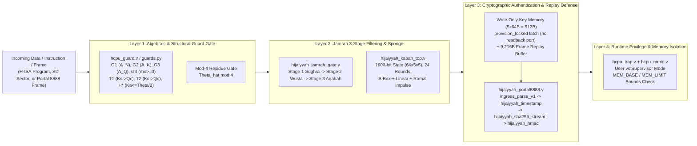

# COSMICTERA — SECURITY, CRYPTOGRAPHY & VERIFICATION ARCHITECTURE (`CT-01-REV13`)

> **REVISION NOTICE (`v1.2 — K-01..K-12, R2, CTHETA=0x4E / HDOT=0x52 & GAP-02 Final Edition`):**  
> Paket dokumentasi arsitektur versi `v1.0` sebelumnya dinyatakan **`SUPERSEDED` (Tidak Berlaku sebagai Referensi Rekayasa)** sesuai Keputusan Pemilik (*Owner Architecture Consistency Decision*). Edisi `v1.2` ini menerapkan: (1) definisi resmi label epistemik `R2` dari `cosmictera/RULES.md` (`VF` = *Verified Formally*, `CC` = *Computationally Confirmed*, `DP` = *Design Property*, `EH` = *Engineering Hypothesis*, `AT` = *Aspirational Target*), (2) koreksi penuh `K-01` s.d. `K-12` terhadap `rtl/hcpu_pkg.vh`, `rtl/hcpu_rom.v`, `rtl/hcpu_regfile.v`, `rtl/hcpu_mmio.v`, dan `docs/HISA_SPEC.md`, (3) penetapan resmi `0x4E = CTHETA` (ekstraksi $\hat{\Theta}(H[\text{S1}])$ 8-bit, 1 siklus) dan `0x52 = HDOT` (perkalian titik 14-komponen $\langle H[\text{S1}], H[\text{S2}] \rangle_{14}$ 20-bit, 14 siklus pada `CODEX_PROFILE=2` / 1 siklus pada `CODEX_PROFILE=0,1`; total `105` opcode H-ISA v1.2, `84` di RTL, `21` software-only, `375/375` `test_isa_parity.py` PASS), serta (4) penyelesaian `GAP-02` pada `rtl/hcpu_hisab.v` yang kini menginstansiasi `rtl/hcpu_guard.v` secara kanonik (`R1`).

**Canonical Sources:** `rtl/hcpu_guard.v`, `rtl/hcpu_hisab.v`, `rtl/hcpu_trap.v`, `rtl/hcpu_mmio.v`, `rtl/hijaiyyah_kabah_top.v`, `rtl/hijaiyyah_jamrah_gate.v`, `rtl/hijaiyyah_hmac.v`, `rtl/hijaiyyah_sha256_stream.v`, `rtl/fpga/gowin/hijaiyyah_kabah_gowin_top.v`, `portal8888/rtl/hijaiyyah_portal8888.v`, `src/hijaiyyah/crypto/{kabah,jamrah,hijrah,cube}.py`, `src/hijaiyyah/nui/{layer5,layer7,layer7_decision}.py`.

---

## 1. Diagram Aliran Keamanan & Verifikasi Berlapis (`09_security_and_verification_flow`)

---

## 2. Empat Lapisan Pertahanan Perangkat Keras & Perangkat Lunak

### Lapis Pertahanan 1 — Penjaga Invarian Aljabar (`rtl/hcpu_guard.v` & `rtl/hcpu_hisab.v`)
- Setiap operasi modifikasi vektor kodeks (`HLOAD`, `HCADD`, `CSET`, `HGUARD`, `HCHECK`) dievaluasi secara kombinasional dalam 1 siklus terhadap 7 invarian: `G1`, `G2`, `G3`, `G4` ($\rho = \hat{\Theta} - U \ge 0$), `T1`, `T2`, dan `H*`.
- Instruksi `HGRD` (`0x60`) / `HCHK` (`0x68`, software-only) mengevaluasi invarian struktural, sedangkan `JGD` (`0x29`) dan `JNGD` (`0x2A`) memungkinkan percabangan cepat berdasarkan bendera `FLAG_G`.
- `rtl/hcpu_hisab.v` menyematkan byte `guard_status` (`{2'b00, t2, t1, g4, g3, g2, g1}`) dan digest **CRC32 (`0xEDB88320`)** ke setiap frame `HISAB` 14-byte.

### Lapis Pertahanan 2 — Gerbang Jamrah 3-Tahap & Spons Ka'bah 1600-Bit (`rtl/hijaiyyah_jamrah_gate.v` & `rtl/hijaiyyah_kabah_top.v`)
1. **Gerbang Jamrah 3-Tahap (`hijaiyyah_jamrah_gate.v`, `DP`)**:
   - Menyaring aliran masukan melalui tiga tahap berurutan: **Sughra** (validasi paritas/struktur dasar), **Wusta** (konsistensi residu dan kapasitas), dan **Aqabah** (kelayakan akhir sebelum masuk ke inti kriptografi).
   - **Temuan Forensik yang Jujur (`cosmictera-build/OFF.md` & `NUI/LAYERS.md` baris 1798)**: Pada bitstream slot Ka'bah awal, gerbang Jamrah sempat di-bypass di luar jalur kritis; temuan ini ditemukan oleh `jamrah_board.py` dan dicatat secara transparan di `OFF.md`.
2. **Inti Spons Ka'bah 1600-Bit (`rtl/hijaiyyah_kabah_top.v` & `hijaiyyah_rotate_core.v`)**:
   - Mengelola keadaan internal `1.600` bit (`64` lane × `5×5` matriks) selama `24` putaran yang menggabungkan `hijaiyyah_sbox_router`, `hijaiyyah_sbox`, `hijaiyyah_linear`, `hijaiyyah_round_constants`, dan `hijaiyyah_ramal_impulse`.
   - **Temuan Forensik Kriptografi (`3ccf193`, `OFF.md`)**: Analisis diferensial/linier membuktikan bahwa transformasi putaran Ka'bah murni memiliki rank `1.276 / 1.600` (bukan bijeksi/permutasi penuh atas $\{0,1\}^{1600}$). Oleh karena itu, arsitektur keamanan CosmicTera **tidak pernah mengandalkan Ka'bah murni sendirian** untuk jaminan MAC kriptografis, melainkan membungkusnya dengan **Layer-3 HMAC-SHA256 (`hijaiyyah_hmac.v` + `hijaiyyah_sha256_stream.v`)** di `hijaiyyah_kabah_gowin_top.v` (`KABAH_WITH_HMAC`).

### Lapis Pertahanan 3 — Portal 8888 Hardware Authentication (`portal8888/rtl/hijaiyyah_portal8888.v`)
- **Status**: `CC` (`11/11` testbench Verilog lulus di `portal8888/tb/`).
- **Submodul Internal**:
  - `ingress_parse_v1 u_ingress`: Mengurai header frame, ID sesi/slot kunci, timestamp, panjang payload, dan tag autentikasi.
  - `hijaiyyah_timestamp u_timestamp`: Memeriksa kesegaran *timestamp* monotonik untuk menolak serangan *replay*.
  - `hijaiyyah_sha256_stream u_frame_sha256` & `hijaiyyah_hmac u_hmac`: Menghitung digest SHA-256 dan memverifikasi tag **HMAC-SHA256** secara perangkat keras.
- **Penyimpanan Kunci Tulis-Saja (`key_mem[0:511]`)**: Menyimpan `5` slot kunci × `64` byte (`512` byte total). Setelah perintah provisi kunci (`0x01`) selesai, register `provision_locked` terkunci tinggi sampai `rst_n` ditarik rendah secara fisik, dan **tidak ada port baca balik (*zero readback port*)** ke UART TX.
- **Buffer Anti-Replay (`frame_mem[0:9215]`)**: Menyimpan frame hingga `9.216` byte di dalam BSRAM dan hanya meneruskan frame apabila verifikasi HMAC dan *timestamp* keduanya sah.

### Lapis Pertahanan 4 — Isolasi Hak Istimewa HCPU & Gerbang Fail-Closed NUI
1. **Proteksi Supervisor/User & Memori HCPU (`rtl/hcpu_trap.v` & `rtl/hcpu_mmio.v`)**:
   - Saat `in_user == 1` (mode User), setiap upaya mengakses jendela periferal `0xFE0–0xFFF` atau mengeksekusi instruksi sistem membangkitkan `priv_fault` (`CAUSE_PRIV = 3`).
   - Setiap akses `LOAD`/`STORE` di luar rentang `[mem_base, mem_limit]` (`0xFFE–0xFFF`) membangkitkan `mem_fault` (`CAUSE_MEM = 4`) sebelum penulisan RAM terjadi.
2. **Pagar Hanya-Baca NUI Lapis 5 & Kontrak Fail-Closed Lapis 7 (`src/hijaiyyah/nui/layer5.py`, `layer7.py`, `layer7_decision.py`)**:
   - Lapis 5 memblokir seluruh karakter meta-shell, penulisan berkas di dalam VM, serta perintah di luar daftar izin 11 kolektor.
   - Lapis 7 menolak setiap tindakan otonom (`DENY` / `STOP / REPORT`) apabila bukti basi (`STALE`), target ambigu (`AMBIGUOUS_TARGET`), atau menyentuh area `NOT_COVERED` / `KNOWN_DISCREPANCY`.
