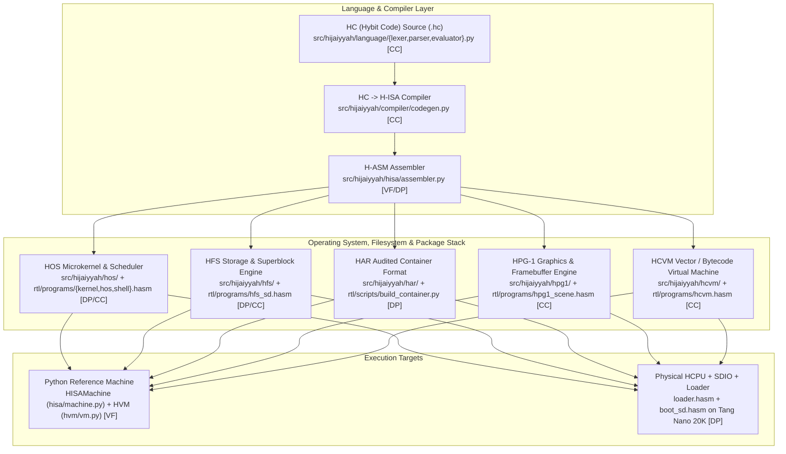

# COSMICTERA — SOFTWARE & RUNTIME ARCHITECTURE (`CT-01-REV13`)

> **REVISION NOTICE (`v1.2 — K-01..K-12, R2, CTHETA=0x4E / HDOT=0x52 & GAP-02 Final Edition`):**  
> Paket dokumentasi arsitektur versi `v1.0` sebelumnya dinyatakan **`SUPERSEDED` (Tidak Berlaku sebagai Referensi Rekayasa)** sesuai Keputusan Pemilik (*Owner Architecture Consistency Decision*). Edisi `v1.2` ini menerapkan: (1) definisi resmi label epistemik `R2` dari `cosmictera/RULES.md` (`VF` = *Verified Formally*, `CC` = *Computationally Confirmed*, `DP` = *Design Property*, `EH` = *Engineering Hypothesis*, `AT` = *Aspirational Target*), (2) koreksi penuh `K-01` s.d. `K-12` terhadap `rtl/hcpu_pkg.vh`, `rtl/hcpu_rom.v`, `rtl/hcpu_regfile.v`, `rtl/hcpu_mmio.v`, dan `docs/HISA_SPEC.md`, (3) penetapan resmi `0x4E = CTHETA` (ekstraksi $\hat{\Theta}(H[\text{S1}])$ 8-bit, 1 siklus) dan `0x52 = HDOT` (perkalian titik 14-komponen $\langle H[\text{S1}], H[\text{S2}] \rangle_{14}$ 20-bit, 14 siklus pada `CODEX_PROFILE=2` / 1 siklus pada `CODEX_PROFILE=0,1`; total `105` opcode H-ISA v1.2, `84` di RTL, `21` software-only, `375/375` `test_isa_parity.py` PASS), serta (4) penyelesaian `GAP-02` pada `rtl/hcpu_hisab.v` yang kini menginstansiasi `rtl/hcpu_guard.v` secara kanonik (`R1`).

**Canonical Sources:** `src/hijaiyyah/hos/`, `src/hijaiyyah/hfs/`, `src/hijaiyyah/har/`, `src/hijaiyyah/hpg1/`, `src/hijaiyyah/hcvm/`, `src/hijaiyyah/language/`, `src/hijaiyyah/compiler/codegen.py`, `src/hijaiyyah/hisa/machine.py`, `src/hijaiyyah/hvm/vm.py`, `rtl/programs/{loader,boot_sd,kernel,hos,shell,hfs_sd,hpg1_scene,hcvm}.hasm`.  
**Epistemic Status:** `DP` untuk `loader.hasm`, `boot_sd.hasm`, `kernel.hasm`, `hos.hasm`, `shell.hasm`, dan `HAR` di papan Tang Nano 20K; `CC` untuk pustaka Python HOS/HFS/HPG-1/HCVM/HC Compiler.

---

## 1. Diagram Arsitektur Perangkat Lunak & Runtime (`07_hos_hfs_hpg1_hcvm_har_software_architecture`)

---

## 2. Rantai Kompilasi Bahasa HC (`Hybit Code`) ke H-ISA (`src/hijaiyyah/language/` & `compiler/`)

1. **Lexer (`src/hijaiyyah/language/lexer.py`)**:
   - Memindai kode sumber `.hc`.
   - **Aturan Karakteristik**: Huruf Hijaiyyah tunggal yang berdiri sendiri (`ا` s.d. `غ`) dipetakan langsung menjadi token literal `HIJAIYYAH` (vektor kodeks 18D), bukan nama identifier (`lexer.py` baris 89). Oleh karena itu, dalam rancangan multibahasa (`NUI/LAYERS.md`), nama variabel Arab wajib berupa kata multi-huruf (mis. `العدد`), bukan huruf tunggal.
2. **Parser & Evaluator (`src/hijaiyyah/language/parser.py`, `evaluator.py`)**:
   - Membangun pohon sintaks abstrak (AST) untuk deklarasi `let`, fungsi `fn`, percabangan `if/else`, perulangan `while`, operasi aritmetika/kodeks, serta pemanggilan bawaan `print`/`println`.
3. **Code Generator (`src/hijaiyyah/compiler/codegen.py`)**:
   - Menurunkan AST HC menjadi instruksi assembly H-ISA (`.hasm`).
   - **Bukti Terukur (`NUI/LAYERS.md` baris 145–150)**: Program `let angka = 10; let harga = 20; println(angka + harga);` dikompilasi menjadi tepat 5 instruksi (`MOVI R0, 10`, `MOVI R1, 20`, `ADD R2, R0, R1`, `PRINT R2`, `HALT`) yang menghasilkan keluaran `30` baik di interpreter maupun di RTL.
   - **Batas Alokasi Register yang Terdokumentasi (`NUI/LAYERS.md` baris 172–177)**: `codegen.py` dapat mengalokasikan hingga `R17` (`GPR_COUNT = 18`), sedangkan `assembler.py` membatasi operand field 4-bit pada `R0–R15`. Program dengan `>16` variabel hidup ditolak secara eksplisit oleh assembler (`register R16 is out of range (max R15)`).

---

## 3. Dua Mesin Eksekusi Referensi Python (`HISAMachine` vs `HVM`)

| Mesin Python | Berkas Sumber | Peran & Karakteristik Arsitektural | Status |
| :--- | :--- | :--- | :---: |
| **`HISAMachine`** | `src/hijaiyyah/hisa/machine.py` | **Oracle Ground Truth Lapis 3 & Lapis 4**: mengeksekusi kata biner 32-bit H-ISA langkah demi langkah (`step()`), memodelkan 18 GPR, 16 H-Reg 144-bit, FLAGS, RAS 8-entri, jendela MMIO `0xFE0–0xFFF`, unit trap/privilege, dan kartu SD virtual. | `VF` / `DP` |
| **`HVM` (Hijaiyyah Virtual Machine)** | `src/hijaiyyah/hvm/vm.py` | Mesin virtual tingkat tinggi untuk eksekusi cepat program H-ISA, debugging interaktif, serta integrasi CLI/API (`44ba928` menyelaraskan seluruh opcode RTL). | `CC` |

---

## 4. Sistem Operasi HOS (`src/hijaiyyah/hos/` & `rtl/programs/{kernel,hos,shell}.hasm`)

1. **Bootloader Kabel UART (`rtl/programs/loader.hasm`)**:
   - Berjalan dalam mode Supervisor pada alamat `0x000`.
   - Mem-polling `REG_RX_STATUS` (`0xFF1`) dan membaca `REG_RX_DATA` (`0xFF0`) untuk menyusun kata instruksi 32-bit, menulisnya ke `REG_IMEM_ADDR` (`0xFF3`) dan `REG_IMEM_DATA` (`0xFF7`), mengatur batas proteksi memori (`REG_MEM_BASE = 0xFFE` / `REG_MEM_LIMIT = 0xFFF`), menulis alamat awal payload `0x040` ke `REG_TRAP_EPC` (`0xFF9`), mengatur `REG_TRAP_MODE` (`0xFFD`, bit `[1]` = User Mode di `hcpu_trap.v`; `MODE_USER=0`/`MODE_SUPER=1` di `hcpu_pkg.vh`), lalu mengeksekusi `ERET` (`0x08`) untuk melompat ke program pengguna (`NUI/LAYERS.md` baris 380–387).
2. **Bootloader Kartu MicroSD (`rtl/programs/boot_sd.hasm`)**:
   - Menginisialisasi kartu SD melalui MMIO `0xFE0–0xFE6`, membaca sektor kontainer HAR, memverifikasi checksum perangkat keras `SD_CSUM` (`0xFE5`) dan guard, menyalin kata instruksi ke IMEM, lalu menyerahkan eksekusi ke payload.
3. **Kernel Preemptif & Guard Daemon (`rtl/programs/kernel.hasm` & `hos.hasm`)**:
   - Menangani 6 penyebab trap (`Timer`, `UART RX`, `Illegal`, `Privilege Fault`, `Memory Bounds Fault`, `SYSCALL`).
   - Menyimpan konteks proses saat interupsi timer berdetak, menjalankan penjadwal *round-robin* antar-proses mode User dengan isolasi jendela memori `MEM_BASE`/`MEM_LIMIT`, dan menjalankan *guard daemon* (`JGD`) untuk memastikan integritas register kodeks.
4. **Interactive Shell (`rtl/programs/shell.hasm`)**:
   - Antarmuka baris perintah interaktif melalui UART (`115.200 8N1`) menggunakan instruksi `EMITS` (`0xA2`) untuk mencetak prompt tanpa karakter baris baru paksa.

---

## 5. Sistem Berkas HFS, Kontainer HAR, Grafika HPG-1 & HCVM

- **HFS (`src/hijaiyyah/hfs/` & `rtl/programs/hfs_sd.hasm`, `hfs_lifecycle.hasm`)**:
  Mengelola tata letak blok/sektor pada kartu MicroSD (superblock, tabel inode/direktori, pembacaan/penulisan sektor 512-byte via buffer 128-kata `SD_DATA`, dan validasi invarian Hijaiyyah pada metadata berkas).
- **HAR (`src/hijaiyyah/har/` & `rtl/scripts/build_container.py`)**:
  *Hijaiyyah Audited Repository/Archive* — format kontainer biner teraudit yang membungkus header magic, jumlah kata, payload instruksi H-ISA, vektor tanda tangan kodeks 18D, dan CRC32 untuk pemuatan melalui UART maupun kartu SD.
- **HPG-1 (`src/hijaiyyah/hpg1/` & `rtl/programs/hpg1_scene.hasm`)**:
  *Hijaiyyah Procedural Graphics 1* — mesin grafika berbasis ubin (*tile*), palet warna deterministik yang diturunkan dari komponen kodeks 18D, dan primitif geometri untuk merender adegan 2D tanpa ketergantungan GPU eksternal.
- **HCVM (`src/hijaiyyah/hcvm/` & `rtl/programs/hcvm.hasm`)**:
  *Hijaiyyah Codex Virtual Machine* — mesin virtual bytecode portabel yang berjalan di atas H-ISA dan Python untuk mengeksekusi beban kerja aljabar kodeks terisolasi.
