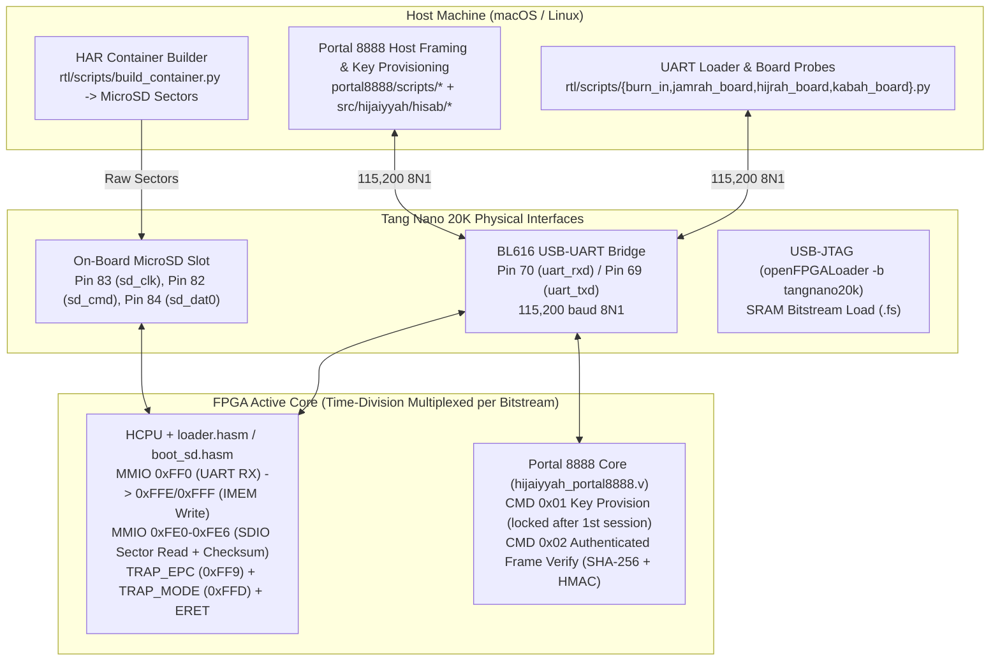
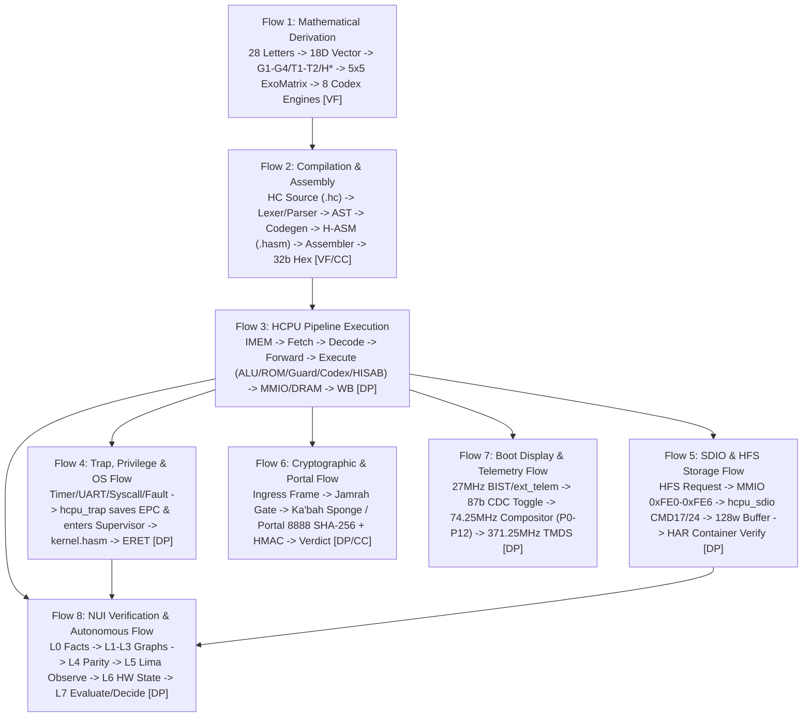

# COSMICTERA — END-TO-END SYSTEM DATA & CONTROL FLOW (`CT-01-REV13`)

> **REVISION NOTICE (`v1.2 — K-01..K-12, R2, CTHETA=0x4E / HDOT=0x52 & GAP-02 Final Edition`):**  
> Paket dokumentasi arsitektur versi `v1.0` sebelumnya dinyatakan **`SUPERSEDED` (Tidak Berlaku sebagai Referensi Rekayasa)** sesuai Keputusan Pemilik (*Owner Architecture Consistency Decision*). Edisi `v1.2` ini menerapkan: (1) definisi resmi label epistemik `R2` dari `cosmictera/RULES.md` (`VF` = *Verified Formally*, `CC` = *Computationally Confirmed*, `DP` = *Design Property*, `EH` = *Engineering Hypothesis*, `AT` = *Aspirational Target*), (2) koreksi penuh `K-01` s.d. `K-12` terhadap `rtl/hcpu_pkg.vh`, `rtl/hcpu_rom.v`, `rtl/hcpu_regfile.v`, `rtl/hcpu_mmio.v`, dan `docs/HISA_SPEC.md`, (3) penetapan resmi `0x4E = CTHETA` (ekstraksi $\hat{\Theta}(H[\text{S1}])$ 8-bit, 1 siklus) dan `0x52 = HDOT` (perkalian titik 14-komponen $\langle H[\text{S1}], H[\text{S2}] \rangle_{14}$ 20-bit, 14 siklus pada `CODEX_PROFILE=2` / 1 siklus pada `CODEX_PROFILE=0,1`; total `105` opcode H-ISA v1.2, `84` di RTL, `21` software-only, `375/375` `test_isa_parity.py` PASS), serta (4) penyelesaian `GAP-02` pada `rtl/hcpu_hisab.v` yang kini menginstansiasi `rtl/hcpu_guard.v` secara kanonik (`R1`).

**Canonical Sources:** `src/hijaiyyah/core/master_table.py`, `src/hijaiyyah/compiler/codegen.py`, `src/hijaiyyah/hisa/{assembler,machine}.py`, `rtl/hcpu_top.v`, `rtl/hcpu_mmio.v`, `rtl/hcpu_sdio.v`, `rtl/programs/{loader,boot_sd,kernel}.hasm`, `portal8888/rtl/hijaiyyah_portal8888.v`, `/tmp/stage1_2_cosmictera_boot_ui/rtl/cosmictera_boot_top.v`, `src/hijaiyyah/nui/{layer5,layer6_freeze,layer7}.py`.

---

## 1. Diagram Interaksi Host ↔ FPGA ↔ Portal ↔ SD (`12_host_fpga_portal_system`)

---

## 2. Diagram Aliran Data Ujung-ke-Ujung (`13_complete_data_flow`)

---

## 3. Spesifikasi Rinci Delapan Aliran Data & Kontrol (`Flows 1` s.d. `8`)

### Aliran 1 — Derivasi Matematis ke Silikon (`Mathematical Derivation Flow`, `VF`)
1. `src/hijaiyyah/core/master_table.py` mendefinisikan 28 tupel 18-komponen dan memverifikasi segel SHA-256.
2. `src/hijaiyyah/core/guards.py` memvalidasi `G1–G4`, `T1–T2`, dan `H*` untuk seluruh 28 huruf.
3. `rtl/scripts/gen_rom.py` menurunkan konstanta 144-bit ke dalam `rtl/hcpu_rom.v` (`28 × 144-bit`).
4. `src/hijaiyyah/nui/atom.py` memverifikasi bahwa indeks huruf $i$, opcode H-ISA `0x00 + i`, dan alamat `hcpu_rom.v` identik bit-demi-bit.

### Aliran 2 — Kompilasi Bahasa HC & Perakitan H-ISA (`Compilation & Assembly Flow`, `CC` / `VF`)
1. Kode sumber `.hc` dipindai oleh `src/hijaiyyah/language/lexer.py` (huruf Hijaiyyah tunggal menjadi token literal `HIJAIYYAH`; kata kunci `let`, `fn`, `if`, `while`, `println` menjadi token sintaksis).
2. `src/hijaiyyah/language/parser.py` membangun AST dan `src/hijaiyyah/compiler/codegen.py` menghasilkan instruksi H-ASM (`.hasm`).
3. `src/hijaiyyah/hisa/assembler.py` menjalankan perakitan 2-pass (Pass 1 mengikat alamat label; Pass 2 mengkodekan kata 32-bit `[opcode:8][dst:4][s1:4][s2:4][imm:12]`) menghasilkan citra `.hex` untuk BSRAM `imem` atau pemuat UART/SD.

### Aliran 3 — Eksekusi Pipa 5-Tahap HCPU (`Pipeline Execution Flow`, `DP`)
1. **IF (`hcpu_fetch.v`)**: Mengeluarkan `imem_addr[11:0]` dan `imem_ce=1` ke BSRAM `imem`; menerima `if_instruction[31:0]` bersama status `if_pc_valid`.
2. **ID (`hcpu_decode.v` + `hcpu_regfile.v`)**: Memecah field instruksi, membaca `gpr_rdata1/2` (`32-bit`) dan `hreg_rdata1/2` (`144-bit`), serta memeriksa hazard `load_use_hazard` dan `store_load_hazard`.
3. **Forwarding (`hcpu_forward.v`)**: Menyuntikkan hasil terbaru dari tahap `EX` atau `MEM` (`fwd_gpr_s1/s2`, `fwd_hreg_s1/s2`, `fwd_hreg_ovf_s1/s2`) tanpa menunggu siklus tulis balik.
4. **EX (`hcpu_execute.v`)**: Mengeksekusi operasi skalar, cabang, atau memicu co-engine paralel (`hcpu_rom`, `hcpu_guard`, `hcpu_codex_alu`, `hcpu_hisab`). Jika `OP_HDOT` dijalankan pada `CODEX_PROFILE = 2`, `calu_done` turun selama 13 siklus dan `hcpu_controller.v` menahan pipa (`pc_stall`, `id_stall`, `ex_stall`) hingga siklus ke-14.
5. **MEM (`hcpu_memory.v` + `hcpu_mmio.v` + `hcpu_dataram.v`)**: Mengarahkan alamat `< 0xFE0` ke `hcpu_dataram.v` dan alamat `>= 0xFE0` ke periferal MMIO dengan latensi baca terdaftar 1 siklus yang seragam.
6. **WB (`hcpu_writeback.v`)**: Menulis hasil ke `hcpu_regfile.v` dengan bypass *write-through* ke tahap `ID`/`EX`.

### Aliran 4 — Pemuatan Program UART (`loader.hasm`) & Konteks Trap (`Trap & OS Flow`, `DP`)
1. Saat papan menyala dengan `loader.hasm` di alamat `0x000` (mode Supervisor), HCPU mem-polling `REG_RX_STATUS` (`0xFF1`) hingga bit `rx_ready` bernilai `1`, lalu membaca byte dari `REG_RX_DATA` (`0xFF0`).
2. Empat byte dirakit menjadi satu kata instruksi 32-bit dan ditulis ke `REG_IMEM_DATA` (`0xFF7`), yang secara kombinasional mengaktifkan `imem_we` dan menaikkan `imem_waddr` (`0xFF3`).
3. Setelah seluruh kata instruksi diterima, `loader.hasm` menulis alamat awal program (`0x040`) ke `REG_TRAP_EPC` (`0xFF9`), menulis `1` (`User Mode`) ke `REG_TRAP_MODE` (`0xFFD`), dan mengeksekusi `ERET` (`0xFD`).
4. Saat terjadi interupsi timer (`src_timer`) atau `SYSCALL` di mode User, `hcpu_trap.v` menunggu hingga `pc_valid & calu_done` bernilai `1`, menyimpan alamat kembali yang tepat (`branch_taken_w ? branch_target_w : if_pc`), beralih ke mode Supervisor, dan mengalihkan `PC` ke `REG_TRAP_VECTOR` (`0xFF8`).

### Aliran 5 — Penyimpanan Kartu MicroSD & Kontainer HAR (`SDIO & HFS Storage Flow`, `DP`)
1. Program (`boot_sd.hasm` / `hfs_sd.hasm`) menulis perintah `INIT` (`1`) ke `SD_CMD` (`0xFE0`).
2. `rtl/hcpu_sdio.v` menjalankan urutan inisialisasi fisik `CMD0 -> CMD8 -> CMD55 -> ACMD41` dengan penyisipan celah clock `N_CC` wajib (`708a9cd`) hingga `sd_card_ready = 1`.
3. Untuk membaca sektor, program menulis nomor LBA ke `SD_SECTOR` (`0xFE2`) dan perintah `READ` (`2`) ke `SD_CMD` (`0xFE0`). `hcpu_sdio.v` mengirim `CMD17`, menerima 512 byte data + CRC16 melalui `sd_dat0`, mengisi buffer 128-kata, dan menghitung checksum perangkat keras di `SD_CSUM` (`0xFE5`).
4. CPU membaca 128 kata secara berurutan dari `SD_DATA` (`0xFE3`) tanpa penundaan siklus ekstra karena jalur baca `sd_data_sel` melewati registrasi ganda (`hcpu_mmio.v` baris 286–295).

### Aliran 6 — Autentikasi Kriptografi Portal 8888 (`Cryptographic & Portal Flow`, `CC`)
1. Host mengirimkan frame provisi kunci (`CMD 0x01`) ke `hijaiyyah_portal8888.v` melalui UART (`115.200 8N1`); modul mengisi `key_mem[0:511]` (5 slot × 64B) dan mengunci `provision_locked <= 1`.
2. Saat frame data autentikasi (`CMD 0x02`) masuk, `ingress_parse_v1` mengekstrak header dan menulis payload ke `frame_mem[0:9215]`, `hijaiyyah_timestamp` memvalidasi *timestamp* anti-replay, `hijaiyyah_sha256_stream` menghitung hash aliran, dan `hijaiyyah_hmac` memverifikasi tag HMAC-SHA256 menggunakan kunci dari slot yang diminta.

### Aliran 7 — Telemetri & Tampilan Boot HDMI 720p (`Boot Display & Telemetry Flow`, `DP`)
1. Pada domain `27,0 MHz`, `cosmictera_boot_subsys_bridge.v` memperbarui status 16 subsistem (dari BIST internal atau port `ext_telem_*`) dan mengemasnya ke dalam register `87-bit` disertai pembalikan bit `cdc_req_toggle`.
2. Pada domain piksel `74,25 MHz`, sinkroniser 2-FF mendeteksi transisi `cdc_req_toggle`, mengunci 87 bit ke snapshot tampilan, dan mengirim balik `cdc_ack_toggle`.
3. `cosmictera_boot_compositor.v` membaca koordinat `(pixel_x, pixel_y)` dari `hcpu_video_timing.v`, mengambil piksel logo RGB565 dari `cosmictera_boot_logo_rom.v` (`8` BSRAM) dan karakter teks dari `cosmictera_boot_text_rom.v` (`3` BSRAM) + `hcpu_font_rom.v` (`1` BSRAM), lalu menyerahkan warna piksel ke `cosmictera_boot_render.v` dan `DVI_TX_Top` (`371,25 MHz`) untuk ditampilkan di TV LG.

### Aliran 8 — Observasi Host & Keputusan Otonom NUI (`NUI Verification & Decision Flow`, `DP`)
1. `src/hijaiyyah/nui/layer5.py` mengeksekusi 11 kolektor baca-saja di VM Ubuntu `cosmictera-layer5` melalui `limactl` dan menulis `manifest.json` ber-SHA-256 ke `~/cosmictera-layer5/observations/<run_id>/`.
2. `src/hijaiyyah/nui/layer7.py` (`evaluate()`) memeriksa keutuhan manifest, kesegaran waktu (`freshness`), cakupan model (`rtl_function.json` / `hardware_state.py`), dan tabel otorisasi `NUI/LAYER7.md`.
3. `src/hijaiyyah/nui/layer7_decision.py` membungkus hasil evaluasi menjadi rekaman keputusan deterministik (`ALLOW`, `DENY`, atau `STOP / REPORT`) yang ditandatangani dengan `record_sha256`.
